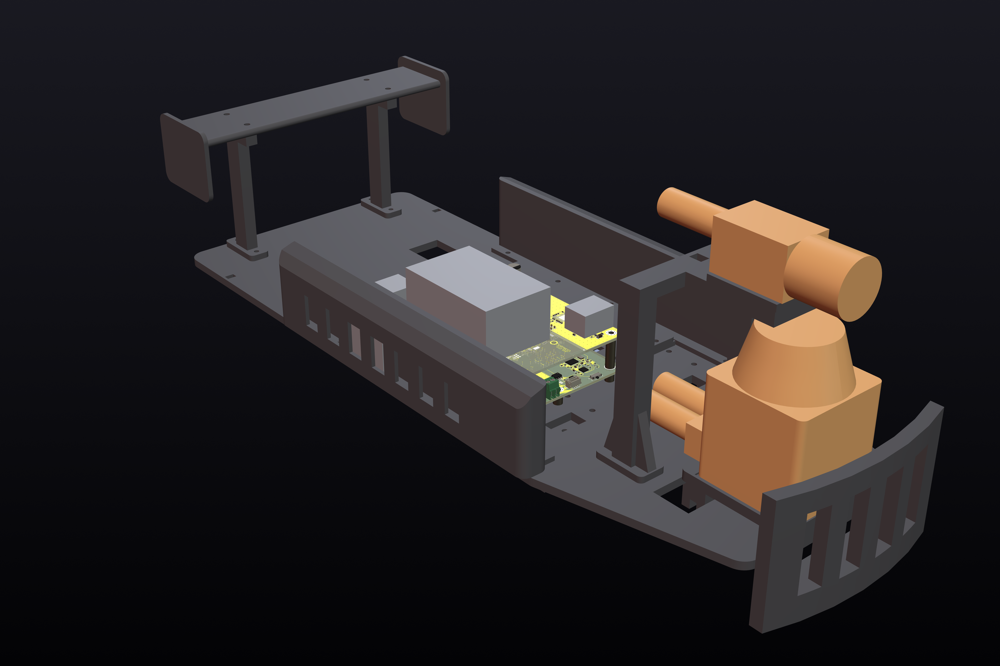

# Atlas car v2

The second Atlas Autoware car: a Traxxas Slash 4x4 with a Holmes Hobbies Puller Pro 540 motor, a SICK TiM561 lidar
and a LUCID Triton camera, built on a carbon-fibre-printed deck.

Rev B (October 2026) is the version being built. Its electronics are:

- **Power board (ATLAS-PWR-1).** A 2-layer board that students solder at school: the motor-bus switch with
  precharge and a hardware E-stop, the power latch, the feeds for the Jetson, lidar, camera, servo and fan, USB-C
  charging, a USB hub so one laptop cable reaches the Jetson, the ESC and the serial console, and a Raspberry Pi Pico
  that sequences it all and talks to the Jetson.
- **The Jetson Orin Nano Super on its NVIDIA dev-kit carrier,** which the team owns, on a printed tray over the power
  board.
- **The team's Flipsky Mini FSESC 6.7 Pro** as the ESC (VESC firmware, the same UART commands as car 1).
- **A JBD 4S smart BMS** with the built-in 4S3P 18650 pack.

`docs/REV_B.md` has the whole design and why it changed. Rev A (two custom boards: a 6-layer drive board with the ESC
on it and an 8-layer Jetson carrier) was finished in September, quoted by PCBWay at $1,927.81 for one assembled set,
and is kept in the repo as history.



The picture is the rev A car; the whole-car renders have not been redone for rev B yet.

## Status

**24 October 2026: rev B is being designed, and nothing has been ordered or built.**

- An independent pre-order review (`docs/review_revb_2026-10-24.md`) said "fix first, then order; no redesign is
  needed". Its one blocker and seven majors are fixed in the design and the firmware (`boards/power/DESIGN_FIXED.md`,
  `firmware/supervisor/NOTES.md`). It asks for three bench tests before ordering; they are listed in `docs/REV_B.md`.
- The power board's schematic, parts list and placement are done (`boards/power/`). `netcheck.py` finds 0 errors and
  14 warnings (small back-power currents into unpowered pins, all within its limits). Parts cost $149.37 per board at
  quantity 1 (`bom/revb/power_board_cost.md`). Layout, routing, DRC and the fab files are in progress
  (`boards/power/HANDOFF_E.md`, `LAYOUT_NOTES.md`); the PCBWay price for the bare boards comes with them.
- The supervisor firmware (`firmware/supervisor/`) passes its 119 tests on a simulated board. It has not run on a
  Pico.
- The Jetson tools (`software/jetson/`) are rewritten for the dev-kit carrier and the supervisor and pass their tests,
  including the real firmware run against them over a pseudo-terminal. Nothing has run on the car.
- The printed kit (`mech/`) is redone for the dev-kit tray, the ESC cradle and the BMS holder. With a 130 mm power
  board both scripts find zero interference. The tray, the BMS holder, the canopy and the splice plates can also be
  laser-cut from 3 mm sheet, and a 3 mm acrylic shield over the live FET bar is always cut (`mech/README.md`,
  "Laser-cut parts"). The dev-kit carrier's hole positions are placeholders until the owned
  board is measured.
- Still to measure before ordering and printing: `docs/MEASURE_FIRST.md`, items 12 and 17-28. The open questions are
  at the end of `docs/REV_B.md`.

## What is in here

| folder | what |
| --- | --- |
| `docs/` | `REV_B.md` (the rev B design and why), `review_revb_2026-10-24.md` (the independent pre-order review), `BUILD_POWER_BOARD.md` (student assembly guide for the power board), `SOFTWARE.md` (what runs on the car), `FLASHING.md` (programming the Pico, the FSESC and the Jetson), `WIRING.md` (every cable run and its length), `MEASURE_FIRST.md` (numbers to check before printing and ordering), `PACK_BUILD.md` (building the 18650 pack); rev A: `ARCHITECTURE.md`, `TPS25751_CONFIG.md`, `COMPLETE_CAR.md` |
| `boards/power/` | rev B power board: `design.py` is the circuit (every value with its reason), `layout.py` the placement and power copper, `PINMAP.md` the Pico pin map, `README.md` the bench tests, `netcheck.py` the electrical checks; the KiCad schematic is generated from them |
| `firmware/supervisor/` | MicroPython for the Pico on the power board: power sequencing, E-stop latch, BMS reading, the USB link to the Jetson; a simulator and tests that run on a PC |
| `software/jetson/` | the `atlas` command, services and settings for the Jetson (`system/install.sh`), with tests |
| `software/ros2/` | `atlas_power`: battery, E-stop, charging and lidar power in ROS 2 |
| `mech/` | the printed kit: `kit.py` (deck, pods, mounts, pack box, dev-kit tray, ESC cradle, BMS holder) and `extras.py` (canopy, bench stand, plugs and cable paths); `NOTES_REVB.md` has the rev B changes and print list |
| `bom/` | rev A parts list and cost summary; `bom/revb/` the power board's parts and cost per block; `cost_summary.md` has both revisions |
| `boards/tools/` | the scripts that build, place, route and check the boards |
| `boards/drive/`, `boards/brain/`, `boards/stack/`, `firmware/vesc/` | rev A (history): the drive board with its VESC target, the Jetson carrier forked from Antmicro's design, and the connector between them |
| `sim/` | rev A circuit and thermal checks |
| `share/` | pictures for posting; `car_scene.py` and `render_car.py` render the whole car (rev A; not yet updated) |

## Cost

From `bom/cost_summary.md` and `docs/REV_B.md` (prices from September and October 2026):

| | rev A | rev B |
| --- | ---: | ---: |
| Electronics for one car (rev A: one assembled PCBWay set; rev B: power board parts, BMS, BEC, fuse, leads, lidar adapter, camera cable) | 1,927.81 | 340.93 + bare boards |
| Pack materials, lens, charger, fan, hardware, antennas | 402.55 | 376.56 |
| Castle Link (one-time, to set the servo BEC) | | 26.99 |
| **One car, new money** | **2,330.36** | **744.48 + bare boards** |

The ESC and the Jetson dev kit are owned and cost nothing new. Assembly is done by students at school. The bare-board
price for the power board comes from the layout step (`boards/power/LAYOUT_NOTES.md`, pending).

## Rebuilding

Rev B:

- **Power board design files.** KiCad 7 or later and Python 3, from `boards/tools`:
  ```
  python3 make_footprints.py power
  KICAD_STOCK_SYMBOLS=/usr/share/kicad/symbols python3 build_sch.py power
  KICAD_FP_DIR=/usr/share/kicad/footprints python3 check_fp.py power
  KICAD_FP_DIR=/usr/share/kicad/footprints python3 fp_lib_from_mod.py power    # first run only
  python3 placer.py power --plot ../power/out/placement.png
  python3 ../power/netcheck.py
  python3 ../../bom/revb/make_power_bom.py
  ```
  The PCB itself (`build_pcb.py`, routing, DRC, fab files) is the layout step: `boards/power/HANDOFF_E.md`.
- **Printed kit.** `pip install cadquery ezdxf shapely matplotlib`, then from `mech/`:
  `POWER_L=130 python3 kit.py`, `POWER_L=130 python3 extras.py` and `python3 ../boards/board_outlines.py`. `kit.py`
  still defaults to a 150 mm board; 130 mm is the length the power board was laid out at.
- **Supervisor firmware.** `python3 -m pytest firmware/supervisor/tests`. To put it on a Pico: MicroPython from
  micropython.org, then `mpremote connect /dev/ttyACM0 cp pins.py hal.py jbd.py link.py sequencer.py main.py :` from
  `firmware/supervisor/` (`firmware/supervisor/README.md`).
- **Jetson tools.** `sudo software/jetson/system/install.sh` on the car; tests with
  `python3 -m pytest software/jetson/tests` (needs `pytest`).

Rev A (history):

- Boards: KiCad 10 and Python 3. `boards/tools/run_kicad.sh` runs every step (schematic, board, routing export and
  import, DRC, renders, fabrication files). Careful with `pcb-drive`: it builds the board again from the placement,
  without the routing.
- VESC target: `firmware/vesc/build.sh` (clones VESC 6.06, adds the two target files, builds; needs
  `arm-none-eabi-gcc`). A build of the committed sources is in `firmware/vesc/prebuilt/`.
- Simulations: ngspice and Python with numpy, scipy and matplotlib; `sim/run_all.sh`.
- Whole-car renders: `python3 share/car_scene.py`, then `python3 share/render_car.py -- car_front_left car_exploded`
  with Blender 4.2's `bpy` module. These use the rev A model and no longer run against the rev B kit.

## Licenses

The brain board is derived from Antmicro's Jetson Orin Baseboard (Apache-2.0); its schematic and
board keep Antmicro's notices, and `boards/brain/vendor/antmicro/fetch.sh` downloads the original. The VESC
hardware target is derived from the VESC firmware (GPL-3.0), so those two files are GPL-3.0.
