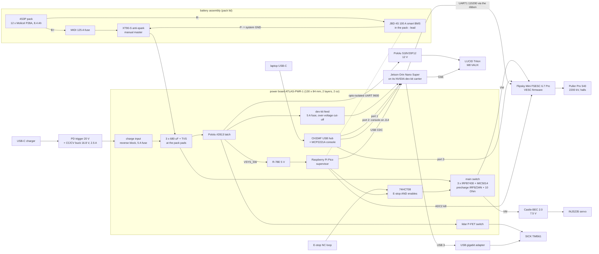

# Car v2 rev B: one power board, the owned dev kit and the owned ESC

Rev B of the second Atlas car (Traxxas Slash 4x4, Holmes Hobbies Puller Pro 540 2200 kV, SICK TiM561, LUCID
Triton). The car does the same job as in rev A. What changes is how it is built: one 2-layer power board that
students solder at school, the NVIDIA dev-kit carrier the team already owns, the Flipsky ESC the team already owns,
and a smart BMS that lives with the pack. `docs/ARCHITECTURE.md` stays as the record of rev A, and its boards stay in
`boards/drive/` and `boards/brain/`.

Status on 2026-10-24: the power board's schematic, parts list and placement are done and have been through an
independent pre-order review (below); the fixes are in (`boards/power/DESIGN_FIXED.md`). `boards/power/netcheck.py`
reports 0 errors and 14 warnings (back-power of 0.05-0.28 mA into unpowered pins, under its 0.5 mA limit, and up to
2.7 mA into the dev kit's 1 kOhm-fed inputs while the dev kit is off). Layout and routing are in progress
(`boards/power/HANDOFF_E.md`, `LAYOUT_NOTES.md`). The supervisor firmware and the Jetson tools pass their tests on
simulated hardware. The printed kit is modelled and has zero interference with a 130 mm board; five of its flat parts
can be laser-cut instead. Nothing has been ordered or built. The student assembly guide is
`docs/BUILD_POWER_BOARD.md`.

## Why rev B exists

Rev A's two boards were finished on 27 September and quoted in October 2026. Each quote is for one assembled set
and five bare boards of each design:

| fab | what | USD |
| --- | --- | ---: |
| PCBWay | drive board: PCB 452.05 (140 x 90 mm, 6 layers, 2 oz on every layer, ENIG, impedance control), assembly 380.36, parts 270.50 | 1,102.91 |
| PCBWay | brain board: PCB 373.34 (120 x 90 mm, 8 layers, filled and capped vias), assembly 253.58 after a discount (760.73 before), parts 197.98 | 824.90 |
| PCBWay | one assembled set, before shipping and duties; assembly lead time 30-35 days | 1,927.81 |
| PCBWay | two assembled sets | about 2,400 |
| JLCPCB | 5 bare and 2 assembled of each, with about 93 placements per set left unplaced | 1,339 |
| IPS Assembly (US) | one of each; two of each | 3,379; 4,305 |

The team had about $2,760 for boards: a $2,060 sponsor gift and about $700. One PCBWay set fits once, with nothing
left for a second car or a respin. JLCPCB's lower price leaves about 93 parts per set for someone else to place
(DRV8323RS, CP2102N, INA228, LAN7800, the M.2 socket, the RJ45s, the stack connector, the inductors and about 40
passives), and most of them are QFN or 0402 parts that need a reflow oven. The price came from the parts: the drive
board had 376 placements on 126 BOM lines (138 resistors and 64 capacitors in 0402, 25 TDSON-8 FETs, a QFN-48
DRV8323RS, an LQFP-64 STM32F405), the brain board 312 placements (a 260-pin SO-DIMM socket, two M.2 sockets, a
QFN-48 LAN7800, a PoE controller with a 52 V boost).

On 24 October Ragini (parent of the founder, Eshan) asked for a redesign: bring the PCB cost down, move as many parts
as possible to through-hole, and do the assembly at school. Reprinting the kit was fine, because filament is cheap and
boards are not.

Rev B stops making the parts of the car that already exist as products. The Jetson goes back on the NVIDIA carrier
the team owns, the ESC is the Flipsky the team owns, and the battery protector is a module. What is left is power
switching, sequencing and distribution, and that fits a 2-layer board of through-hole parts plus 1206 chips that an
iron can solder.

## Pre-order review

An independent review of the design, the firmware and the software (`docs/review_revb_2026-10-24.md`, by a reviewer
who had not seen the design being made) came back with "fix first, then order; no redesign is needed". It found one
blocker and seven majors. The blocker (B1): the CC/CV module's input and output grounds were both on board ground,
which bypasses the current shunt of the common XL4015 module, so constant-current charging would have been lost; the
charger side now has its own ground, CHG_GND. The majors were 10 kOhm series resistors too weak to drive the dev kit's
level-shifted inputs (now 1 kOhm), the dev-kit feed and charge P-FETs running hot at half gate drive (now IRF4905 with
more gate drive), a precharge that could fail with the FSESC and the BEC loading the bus, two firmware behaviours that
could cut a running Jetson or fight the latch, motor current leaking through the FSESC's signal grounds (now through
2.2-3.3 Ohm), and a marginal USB path to the dev kit (now a through-hole USB-A on the board). The design changes are
listed in `boards/power/DESIGN_FIXED.md`, the firmware changes in `firmware/supervisor/NOTES.md`.

The review asks for three bench tests before the boards are ordered. None of them needs the new board:

1. Drive J12 pin 10 of the real dev kit through 10 kOhm from a 3.3 V USB-UART at 115200 while `cat /dev/ttyTHS1` runs
   on it. This shows whether the dev kit's inputs need the 1 kOhm drive the board now has.
2. Precharge the real FSESC and the Castle BEC (set to 7.5 V, with the servo and 1000 uF) through 10 Ohm from a 12 V
   supply, scope on the bus. If the BEC's start-up holds the bus down, its input moves to the alternative pad on the
   switched pack rail (J410) or R313 becomes 4.7 Ohm.
3. Check the CC/CV module in hand: 20 V in, a 4.7 Ohm power resistor on the output, measure from IN- to OUT-. About
   0.1 V means a low-side shunt, which is what the board is built for.

## System

The board stands on six 7 mm standoffs on the deck. A printed tray stands on the same six holes with 25 mm
standoffs and carries the dev-kit carrier on its own holes, I/O edge toward the pack. The FSESC sits in a printed
cradle in the ESC bay beside the motor, in the right pod's fan stream. The BMS stands on its long edge in a printed
holder on the pack lid, with the MIDI fuse holder beside it (`mech/NOTES_REVB.md`). A 3 mm cast acrylic shield hangs
under the tray, 2 mm over the FET heatsink bar, which is live at pack voltage, because the CF-filled tray conducts.
The tray, the BMS holder, the canopy and the four splice plates can also be laser-cut from 3 mm birch plywood or cast
acrylic on the school's CO2 laser instead of printed; those sheets do not conduct (`mech/README.md` and
`mech/PRINTING.md`, "Laser-cut parts").

Why one board and the dev kit, and not a new pair of custom boards: rev A needed two boards because the ESC needed 2 oz
copper for 70-150 A while the Jetson carrier needed eight impedance-controlled layers. With the ESC and the carrier
both already owned, neither requirement is left. Nothing on the power board is fast: two UARTs at 115200 and 9600
baud, gate drive in milliseconds, and one USB 2.0 hub whose runs are kept short. Two layers are enough.

## What you plug in

Once, when building the car. Every run and its length is in `docs/WIRING.md` (rev B section); the lengths there are
provisional until the layout fixes the pad positions.

| connection | to | how |
| --- | --- | --- |
| pack + | MIDI 125 A fuse, then the XT90-S | 10 AWG, M5 ring terminals at the fuse |
| pack - | JBD BMS B- | 10 AWG |
| pack cell taps and NTC | JBD balance and NTC inputs | the pack's 7-pin JST-XH through an adapter harness, off the board |
| battery assembly (XT90-S female, the anti-spark half) | power board BAT+/BAT- pads | a 10 AWG pigtail with an XT90 male, soldered into the pads |
| BMS UART | power board J201 | JBD 4-pin port, adapter lead to a JST-XH 4; opto-isolated on the board |
| FSESC battery leads | power board ESC+/ESC- pads | the FSESC's 12 AWG leads, soldered |
| FSESC COMM | power board J903 | JST-PH 7: UART TX/RX, GND (through 3.3 Ohm on the board), ADC2 kill |
| FSESC servo/PPM output | power board J904 | 3-pin lead; the board buffers it to 5 V for the servo; its ground through 3.3 Ohm |
| FSESC USB | power board hub port 3 (J602, a 1 x 4 header) | the FSESC's micro-USB cable and an Adafruit 4449 jack lead; its ground through 2.2 Ohm |
| motor phases and hall sensor | FSESC | the FSESC's 12 AWG phase leads with 4 mm bullets; the motor's own sensor lead |
| Castle BEC | BEC+ (J401, motor bus) and BEC- pads in, J403 out; BEC+ALT (J410, switched pack rail) if the precharge test needs it | its 16 AWG input leads; its servo-style output plug |
| steering servo | J406 at the front edge | the servo's own lead |
| dev kit power | DEV+/DEV- pads | Tensility 10-01779 5.5 x 2.5 mm right-angle plug lead, 18 AWG |
| dev kit J12 (40-pin) | J801 box header | 150 mm 40-wire IDC ribbon |
| dev kit J14 (button header) | J802 1 x 12 header | Dupont housing, 8 wires, keyed with a printed clip |
| dev kit USB-C | hub port 1: J601, a through-hole USB-A receptacle at the pod edge | one ordinary USB-A to USB-C cable |
| Pico micro-USB | a dev kit USB-A port | micro-USB to USB-A, 0.3 m (supervisor link) |
| lidar power | J409 Phoenix terminal at the front edge | the donor M12 power cable, cut and stripped |
| lidar Ethernet | USB 3 gigabit adapter on a dev kit USB-A port | the donor M12-D to RJ45 cable |
| camera data | dev kit RJ45 | M12 X-coded to RJ45, data only |
| camera power | camera pads, then the Pololu S18V20F12 on the tray | LUCID GPIO-M8 cable: red (pin 1, VAUX) and black (pin 5, GND) |
| power latch | latch pads | Pololu #2813 on the tray; 18 AWG VIN, VOUT, GND and 24 AWG ON, OFF |
| charging modules | charge pads | PD trigger and CC/CV buck in the right pod at the charge window, six 20 AWG wires |
| side-pod fan | J1003 at the rear edge | the fan's own 4-pin lead |
| E-stop loop | J1001 | JST-PH 2, normally closed; a wire loop if no button is fitted |
| remote power button (optional) | J1002 | JST-PH 2, side entry |
| Wi-Fi antennas | M.2 card under the carrier | 20 cm MHF4 to RP-SMA pigtails to the canopy's rear edge |

Every day: **two USB-C ports in the right side pod.** A 65 W USB-C PD charger in the charge port charges the pack. A
laptop on the debug port reaches the Jetson (USB networking at 192.168.55.1 and flashing), VESC Tool on the FSESC and
the Jetson's serial console through the board's hub. Rev A did both on one port. The laptop no longer powers the
car.

## What changed and why

### The Jetson stays on its dev-kit carrier

The custom ATLAS-BRN-1 (an 8-layer fork of Antmicro's Jetson Orin baseboard) is replaced by the NVIDIA dev-kit
carrier the module came on. That removes $824.90 from the PCBWay quote, and the carrier is NVIDIA's validated board,
where the fork had never been built and its own review had found problems in it.

The carrier has every port the car uses: the module's gigabit RJ45 for the camera, four USB 3.2 Type-A ports, the
2280 NVMe slot, the Wi-Fi card, a USB-C port that does device mode (192.168.55.1), host mode and recovery flashing, a
40-pin header (J12) with a free 3.3 V UART, an I2C bus and GPIOs, and a 12-pin button header (J14) with the power
key, reset, recovery and the debug console (NVIDIA carrier specification and user guide).

Its DC jack takes 9-20 V (carrier specification, section 3.8), so the pack's 12.0-16.8 V feeds it directly through a
fuse. The jack is rated 3.5 A in the specification's text. The car runs the 25 W power mode, which needs about 36 W
at the jack: 3.0 A at 12 V, 2.15 A at 16.8 V (module 25 W, NVMe 3.5 W, Wi-Fi 2 W, USB about 1.5 W, fan 0.75 W, divided
by about 0.9 for the carrier). MAXN_SUPER has no power cap and can draw more than the jack's rating at 12 V, so
`install.sh` sets 25 W.

What the carrier does not have, and how rev B covers it:

- **No second Ethernet port.** The TiM561 is 100BASE-TX, so a USB 3 gigabit adapter on a USB-A port is plenty
  (ZimaSpace RTL8153, $9.90). The NetworkManager profile matches the `r8152`, `ax88179_178a` and `lan78xx` drivers.
- **No OS_HALTED pin.** The supervisor takes any of these as "the Jetson has halted": a HALT line sent by a
  systemd-shutdown hook at the very end of a shutdown, J12's 3.3 V (pin 17) gone for 2 s, or no heartbeat for 60 s.
- **No published hole positions.** NVIDIA's specification gives the 100 x 79 mm outline but no holes, so the tray
  carries the carrier on four bosses at placeholder positions until the owned board is measured (MEASURE_FIRST
  item 17). The power board does not depend on them: the tray stands on the board's own six holes.

Auto power-on stays enabled (J14 pins 5 and 6 open), so the Jetson boots as soon as its DC feed appears and the
supervisor only ever presses the power key to shut it down.

### The ESC is the owned Flipsky Mini FSESC 6.7 Pro

The team owns two Flipsky units. The one with "MINI 6.7 PRO" on its silkscreen is the Mini FSESC 6.7 Pro: 70 A
continuous, 200 A instantaneous, 14-60 V, 67 x 39 x 18.7 mm, 130 g (Flipsky). The other, in an aluminium case, may be
the full-size FSESC 6.7 Pro (60 A continuous, 8-60 V, built-in anti-spark switch); which is which is MEASURE_FIRST
item 21. Using the Mini costs $0 and takes the ESC and its MCU off the board: 147 of the 409 parts in the drive
board's design, including every part that blocked hand assembly (the QFN-48 DRV8323RS, the LQFP-64 STM32F405, the
LGA-14 IMU, 12 TDSON-8 FETs, three 4026 shunts and 85 parts in 0402).

It is enough for this car. VESC's motor current is the peak phase current, and with FOC a 70 A motor current draws
at most 60.6 A from the pack, so the 90 A battery limit never binds. Bursts are well inside its rating. Minutes of
70 A with no air would reach VESC's own thermal derating, which is why it sits in the side-pod fan's stream.

Two things to check on the bench. The Mini is rated from 14 V, while the team's VESC battery cut-off starts at 13.4 V
and ends at 12.6 V, so run it at 12.0 V on a bench supply before trusting it (VESC's 60-series firmware itself
allows 6-57 V). Its input capacitance is not published; the precharge assumes 2 mF, and the supervisor reports the
real precharge time (`pre_ms`) so the setting can be corrected.

The FSESC keeps Flipsky's VESC firmware; VESC Tool sets the UART app at 115200, the kill switch on ADC2 (active low),
the servo output, a 250 ms timeout and rev A's limits (`docs/SOFTWARE.md`, "The FSESC"). A custom hand-built ESC was
designed on paper and moved to rev C (below).

### The JBD smart BMS, with the pack

Rev A's BQ7791508 protector, its eight FETs, the 0.5 mOhm shunt and the INA228 are replaced by a JBD (Jiabaida) 4S
100 A smart BMS module in the pack's negative lead. It is configurable (thresholds, delays, design capacity), recovers
from faults on its own, and reports pack voltage, current, cell voltages and temperatures over Bluetooth or a UART
(JBD store listing; Overkill Solar's JBD manual). Settings for the 4S NMC pack: cell over-voltage 4.25 V (above the
charger's 4.20 V, so a cell running slightly high does not end the charge or take away regen on a full pack; review
m12), under-voltage 3.00 V, discharge over-current above the VESC's 90 A battery limit with a 1-2 s delay, charge
over-current about 20 A, charge over-temperature 50 C, discharge 65 C, design capacity 8.4 Ah (`docs/FLASHING.md`,
`boards/power/README.md`).

The MIDI 125 A fuse in the pack's positive lead and the XT90-S anti-spark connector complete the battery assembly.
The fuse is time-delay, so it carries the 90 A battery limit and only opens on a fault the BMS fails to clear. The
XT90-S is the pack connector and the manual master for transport and storage.

The JBD switches the pack's negative lead, so its UART ground is the pack's B-, which is a different node from the
car's ground whenever the BMS is open. Rev A's worst electrical fault came from mixing those two grounds (the INA228
carried the board's return current when the BMS opened). On rev B the cell taps go from the pack to the BMS through a
harness that never touches the board, and the only wired link from the BMS to the board is a pair of optocouplers.

The JBD is 160 x 105 x 10 mm. It does not fit flat on the 138 x 51 mm pack lid or inside the pack box, so it stands on
its long edge in a printed holder on the lid's outboard edge, inside the lidar's rear blind sector
(`mech/NOTES_REVB.md`).

### Charging: a USB-C PD trigger and a CC/CV buck

Rev A's TPS25751D PD controller, its EEPROM and the BQ25798 buck-boost charger (two QFNs and about 40 passives) are
replaced by two modules in the right side pod at the charge window:

- an Adafruit 5807 (HUSB238) PD trigger, with its jumpers cut so it asks the charger for 20 V at 3 A;
- an XL4015-class CC/CV buck module set to 16.80 V and 2.5 A.

On the board, the charge input has a P6KE24A TVS and a 10 uF capacitor, then a reverse-block P-FET (IRF4905, 20 mOhm)
that turns fully on only while the input is above about 17.5 V, so a 5, 9, 12 or 15 V fallback from the charger never
enables it, then a 5 A mini blade fuse into the pack bus ahead of the latch and the main switch. Because the P-FET
has no diode drop once it is on, the buck is set to 16.80 V (4.20 V per cell). The Phase 2 plan said 17.1 V because it
assumed a diode.

The common XL4015 module measures its output current with a shunt between its IN- and OUT- terminals, so the
charger side (the PD trigger's ground, the buck's IN-, the input TVS and capacitor, the 20 V detector) has its own
ground, CHG_GND, which meets the car's ground only through the module (review B1). The module in hand is checked on
the bench before it is wired in (`docs/BUILD_POWER_BOARD.md`).

That is 2.5 A at up to 16.8 V, about 42 W into the car from a 65 W charger. 8.4 Ah at 2.5 A is about 3.4 hours from
empty, plus the slower constant-voltage finish. With the car on, the dev kit's 36 W takes most of it, so the pack
barely charges while you debug. The BMS balances and protects in every case. Charging needs no button press and turns
nothing on.

### The power board, ATLAS-PWR-1

130 x 84 mm, 2 layers, 2 oz copper, 1.6 mm, HASL, no impedance control, 0.25 mm minimum track and gap, 0.3 mm
minimum drill. Sources in `boards/power/`: `design.py` is the circuit, with the reason for every value, `layout.py`
the placement and the hand-drawn power copper, `PINMAP.md` the Pico pin map.

**Size and the 1206 compromise.** The printed kit sets the length: at 150 mm the board's front 3.4 mm sits inside the
TiM561's M12 plugs (an estimate: 45 mm long plugs, MEASURE_FIRST item 12), and at 130 mm both kit scripts report zero
interference. With every part through-hole, the courtyards alone come to about 11,800 mm2 on a 10,920 mm2 board, and
even at 150 mm the placement did not close. So the resistors and small capacitors (104 of them since the review) are
1206 chips (1210 for the five 10 uF parts) on the bottom side, with KiCad's longer hand-solder pads. They solder with
an iron and tweezers. Every IC, transistor, diode, electrolytic, connector and power part is through-hole: 80 parts on
the top, three of them the DIP sockets for the MIC5014, the 74HCT08 and the MCP2221A. The Pico and the USB hub module
stand on 8.5 mm sockets with small parts underneath them. An all-through-hole board would need roughly 160 mm, or a
second, stacked logic board.

**Heights.** Parts under the dev-kit tray are 23 mm or less; the tallest are the three 680 uF capacitors (12.5 x
20 mm, about 21 mm installed) and the FETs on their bar (about 20 mm).

The blocks, as `design.py` names them:

**A. Pack input.** A 10 AWG pigtail soldered into two plated pads, with an XT90 male on its end that mates with the
pack's XT90-S female (the half with the anti-spark resistor). A board-mount XT90 was dropped: its drawing could not be
read, and Amass rates the part 30 A (UL). Three Panasonic EEU-FR1V681 (680 uF 35 V low-ESR, 2 mF in all) sit at the
pads, so a main-switch trip or a BMS cut cannot ring the bus up; rev A had no bulk capacitance there, and its review
simulated 31-63 V spikes on the pack bus at main-switch trips. A 1.5KE20A TVS (17.1 V standoff, above the 16.8 V full
charge; 27.7 V clamp) across the pads.

**B. BMS link.** The JBD's 4-pin UART (1 VDD, 2 TX, 3 RX, 4 GND per the Overkill/JBD manual) comes in on a JST-XH 4
(J201) through an adapter lead and reaches the Pico's UART0 at 9600 baud through two PC817 optocouplers. The BMS side
is powered from the port's own VDD and keeps 2 mm from every other net, with no copper pour across the gap.

**C. Main switch, precharge and the E-stop gate.** Three Infineon IRFB7430 (40 V, 1.3 mOhm maximum at 10 V, TO-220)
in parallel on the high side, driven by a Microchip MIC5014 charge-pump driver in DIP-8 that clamps the gate 13-17 V
above the source. High side keeps the ESC's ground the same as the Jetson's; a low-side switch would let the ESC's
ground float whenever the switch is off. A single P-FET would have been simpler to drive, but the best -40 V TO-220
P-FET (Infineon IPP120P04P4L03, 3.1 mOhm) is end-of-life and the remaining ones are 7-20 mOhm. At the 90 A battery
limit each FET carries 30 A and loses about 1.9 W hot.

The three tabs are drains, all at pack plus, so they bolt to one 40 x 15 x 3 mm aluminium bar with no insulators. The
bar is live at pack voltage. A 10 kOhm NTC bent against it (with Kapton between) goes to a Pico ADC through a further
10 kOhm, so a chafed coating cannot put the pack onto the pin (review m6). Each gate has its own 10 Ohm resistor for
current sharing, and 2.2 MOhm gate to source keeps the FETs off with the driver out of its socket (100 kOhm loaded the
MIC5014's charge pump, review m1). Turn-off of 0.9-1.2 uC of gate charge is estimated at 0.1-0.4 ms: slow enough to
keep the spike on the pack leads small, fast enough to keep the FETs in their safe operating area. That estimate needs
a bench check.

Precharge is an IRF9Z34N P-FET, a Bourns MF-R050 polyfuse and a 10 Ohm 5 W cement resistor into the motor bus: a
20 ms time constant into 2 mF and 0.28 J per start. The polyfuse trips if precharge is left on into a short (the
resistor would otherwise take 28 W).

The E-stop gate is a 74HCT08: MAIN_EN AND ESTOP_OK drives the MIC5014, PRECHARGE_EN AND ESTOP_OK drives the
precharge FET. An open loop turns both off with no firmware in the path. The Pico's two enables have 100 kOhm
pull-downs, so a Pico reset opens the switch too. A 1.5KE22A (18.8 V standoff) clamps the motor bus for regen with
the BMS open. A red LED shows the motor bus is live.

**D. Latch and rails.** A Pololu #2813 pushbutton power switch (4.5-40 V, 6 A continuous, under 0.2 uA off, ON and
OFF pulse inputs) sits on the tray, wired to the board. The button pulls its ON input high through 33 kOhm from the
pack and also tells the Pico it was pressed; the Pico ends power with a pulse on OFF. A crash or reset of the Pico
does not switch the car off, because the module reacts only to pulses. Its output, VSYS_SW, feeds the rest of this
block:

- 5 V: a RECOM R-78E5.0-1.0 (28 V maximum input) behind 4.7 Ohm and a P6KE20A, so a 30 V spike reaches it clamped
  (R408 was 10 Ohm; 4.7 Ohm drops less when a sagging pack is near the R-78E's 8 V minimum, review m9). It feeds the
  Pico (through a 1N5817, so the Pico's own USB cable cannot back-feed the rail), the logic and the fan.
- Dev kit: a 5 A mini blade fuse, a P6KE22A, then an over-voltage cut-off (a TL431 switches an IRF4905 off at
  18.7 V and back on at 17.85 V; 6.8 kOhm in its gate divider gives -7.1 V of gate drive at 12 V, and 100 nF gives a
  soft start), 220 uF and two 18 AWG pads. The carrier is rated 9-20 V, and regen with the BMS open or a failed
  charger could push the bus past that. The same P-FET lets the Pico power-cycle a hung Jetson (GP22). The first
  draft used an IRF9Z34N at half the gate drive; at the dev kit's 3 A it would have run 85-140 C hot (review M2).
- Lidar: an IRF9Z34N high-side switch with a soft start, an MF-R075 polyfuse (0.75 A hold; the TiM561 draws about
  0.33 A), a P6KE22A and the Phoenix terminal. A 100 kOhm pull-down keeps it off while the Pico is dead; rev A's
  lidar enable had a pull-down too weak for that. The two P6KE22A sit above the pack TVS's 19-21 V band, so in a
  sustained over-voltage the 1500 W part at the pack takes the current (review m4).
- Camera: an MF-R075 and a P6KE22A, then two pads to the Pololu S18V20F12 off the board (below).
- Servo: a Castle Creations BEC 2.0 takes the motor bus (after the main switch, so an E-stop also drops steering) and
  is set to 7.5 V; it is rated 8 A continuous at 7.25-8.5 V and 14 A peak. A second pad, BEC+ALT (J410), puts it on
  VSYS_SW instead, if the precharge test shows that the BEC's start-up holds the motor bus down (review M3). A 1000 uF
  capacitor at the servo header covers stall pulses. The Pololu regulators checked were either too small at 7.5 V
  (D36V50F7, about 5 A) or larger and dearer (D24V150F7, $79.95).

**E. Charging.** The PD trigger and the CC/CV buck are off the board in the pod (they were moved off to make 130 mm);
the TVS, the 20 V detector, the reverse-block P-FET (IRF4905), the 5 A fuse and the CHG_PRESENT_N line to the Pico
stay on it, all on CHG_GND up to the buck.
CHG_PRESENT_N is an open-collector transistor, because a plain divider from the charge input would back-power an
unpowered Pico while the car charges with the power off.

**F. One cable for debugging.** An Adafruit 5997 CH334F 4-port USB 2.0 hub on sockets. Its own USB-C faces the pod
window and is the laptop port. It is powered by the laptop, and its VBUS goes to the four ports and to nothing else,
so the laptop cannot power the car and the car cannot back-power the laptop. Port 1 goes to a through-hole USB-A
receptacle (J601, Wurth 614004134726) at the pod edge, and one ordinary USB-A to USB-C cable runs from it to the dev
kit's USB-C (USB networking and flashing); the first draft went through a header and a jack lead, which the review
judged marginal at 480 Mb/s (M7). Port 2 goes to an MCP2221A USB-UART on the dev kit's J14 console pins, port 3 to a
1 x 4 header for the FSESC's USB (VESC Tool, full speed only, its ground through 2.2 Ohm), port 4 is spare. The
high-speed pairs run short and coupled over ground; 90 Ohm is not reachable on a 1.6 mm 2-layer board, so runs stay
under 40 mm. If flashing JetPack through the hub fails, the laptop plugs straight into the dev kit.

**G. Supervisor.** The Raspberry Pi Pico in its sockets, two ADC dividers (100k / 18k: 16.8 V reads 2.56 V) for the
motor bus and the pack, and the status and fault LEDs. The pack is sensed from VSYS_SW, so no divider drains the pack
while the car is off.

**H. Jetson.** A 2 x 20 shrouded box header for the ribbon to J12. J12 itself is unshrouded, so the ribbon can go on
turned round, which maps pin n to pin 41 - n. The board leaves pins 1, 2, 4, 24, 37, 39 and 40 open and puts a series
resistor in every line to the dev kit, so a reversed ribbon shorts nothing. The board's outputs toward the Jetson (the
FSESC's TX to pin 10, E-stop and charge status to pins 33 and 32, and the console TX to J14 pin 3) go through 1 kOhm:
the dev kit's level shifters are probably TXB-type translators, which hold their pins through about 4 kOhm, so 10 kOhm
would never have toggled them (review M1; its first bench test settles it). Inputs from the Jetson keep 10 kOhm. UART1
(pins 8 and 10) passes straight to the FSESC COMM header; the FSESC's 3.3 V pin is not connected. A 1 x 12 header
takes the J14 harness: PC817s across pins 12/11 (power key) and 8/7 (reset), a recovery button on 10/9, the console on
3/4/7, and pins 5 and 6 open.

**I. ESC interface.** Wire pads for the FSESC's battery leads, the COMM header (JST-PH 7: TX, RX, GND and ADC2 kill
through 1 kOhm), and the servo-signal input, which a spare 74HCT08 gate buffers from 3.3 V to 5 V. The COMM and
servo-lead grounds reach the board's ground through 3.3 Ohm each (and the FSESC's USB ground through 2.2 Ohm), so the
motor current stays in the ESC- lead: in parallel with it, a 1 mOhm lead at 90 A would have pushed 1-2 A through the
JST-PH ground (review M6).

**J. The rest.** The E-stop loop (3.3 V through 1 kOhm, the normally-closed loop, 10 kOhm and 10 nF to ground: open or
unplugged reads "stop"; the filter is 0.1 ms, down from 1 ms after review m3), the remote button connector, a 4-pin
fan header at the rear edge whose PWM goes through a 2N7000 (the fan runs full speed with the Pico off), six M3 holes
with 7 mm keep-outs.

Parts for one board cost $149.37 at quantity 1 on 2026-10-24, $11.30 of it not verified
(`bom/revb/power_board_cost.md`; $140.67 before the review's changes). Buying for three boards brings the chips down
to a few cents each.

### The supervisor: a Raspberry Pi Pico

Rev A's STM32 ran the motor and the power sequencing together, and its review found the worst firmware bug in that
mix (a crash after a failed precharge). Rev B gives the sequencing its own MCU: a Raspberry Pi Pico (RP2040) in
sockets, running MicroPython so students can read and change it in Thonny with no compiler
(`firmware/supervisor/`).

It precharges the motor bus (done at 90 % of the pack, or within 2.5 V of it once the bus has stopped rising, so the
FSESC and the BEC loading the bus no longer make it fail on the simulator; under 4 V after 10 ms means a short; three
tries), closes the main switch, latches the E-stop until a person presses the button, presses the Jetson's power key
and waits for its halt before switching the car off, reads the BMS and sends a status line to the Jetson once a second
over USB, switches the lidar, runs the fan and watches the heatsink (off above 90 C) and the pack (warning at 12.0 V
for 30 s, clean shutdown at 11.6 V; with a charger in, these pause only while the pack is rising). A 3 s watchdog
resets it if its loop stops; during the reset the board's pull-downs open the main switch and the precharge FET, turn
the lidar off and kill the VESC, while the Jetson stays powered. After any restart it waits for a button press before
it precharges again.

The Pico talks to the Jetson over USB CDC: its micro-USB goes to a dev-kit USB-A port. That leaves the Jetson's only
40-pin UART for the FSESC.

The review changed three behaviours. A lost heartbeat while the Jetson's 3.3 V or JETSON_UP is still high now
presses the power key and waits, where it used to cut a running Jetson after 60 s (M4). The 5 s force-off now cuts the
motor bus, lidar and dev kit at once but pulses the latch's OFF input only after the button is released, because the
held button keeps the latch's ON input high (M5). A press in LOCKOUT with the E-stop loop still open is ignored and
logged (m16). The firmware's 119 tests pass under CPython on a simulated board; none of it has run on a Pico yet.

### The E-stop

Three layers, the first with no firmware in it:

1. The normally-closed loop gates the main switch through the 74HCT08. Opening it cuts the motor bus; the FSESC loses
   power and the motor coasts.
2. The Pico sees the loop open (an interrupt), drops MAIN_EN and PRECHARGE_EN, and pulls the FSESC's ADC2 to 0 V. VESC
   checks its kill switch every 10 ms.
3. The VESC app timeout (about 250 ms with about 10 A of brake current) stops the car if the ROS stack stops sending.

Closing the loop again does nothing until a person presses the button. A main FET that fails shorted defeats the
first layer; the second still stops the motor while the FSESC runs, and the Pico can also tell the BMS to open its
discharge FETs, which switches everything off.

### Camera power from its M8 connector, and no PoE

LUCID's Triton specification reads "PoE (IEEE 802.3af), or 12-24 VDC" external, and its 8-pin M8 GPIO connector has
VAUX (12-24 V in) on pin 1 (red) and ground on pin 5 (black). Edmund Optics lists the TRI023S-CC at 2.5 W on external
power. So the camera is powered from that connector, its RJ45 carries data only, and the car has no PoE: the LM5155
boost, the TPS23861 PSE and the 52 V nets are gone.

12-24 V with 5 % tolerance means 11.4 V minimum, and under hard acceleration on a low pack the bus can sag below that
(the Phase 1 study estimated 2.1-2.7 V of sag at 70-90 A). So the camera gets a regulated 12 V from a Pololu S18V20F12
step-up/step-down module ($29.95, 3-30 V in) on the tray, fed from the board through a polyfuse, with a P6KE22A at
its input (the module's absolute maximum is 32 V, review m18). Whether the owned
camera boots from VAUX with a non-PoE link is MEASURE_FIRST item 23.

## Power budget

| load | power | source |
| --- | --- | --- |
| dev kit in 25 W mode, with NVMe, Wi-Fi, USB and fan | about 36 W: 3.0 A at 12 V, 2.15 A at 16.8 V | NVIDIA carrier specification and Jetson Linux r36.4.3 power modes |
| SICK TiM561 | 4 W typical | SICK datasheet 1071419 |
| LUCID Triton on external power | 2.5 W, plus the S18V20F12's losses | Edmund Optics listing for TRI023S-CC |
| board logic, Pico, fan | about 0.15 A at 5 V | Phase 1 power-board study |
| servo | 7.5 V, 8 A continuous, 14 A peak (BEC rating) | Castle BEC 2.0 (Holmes Hobbies listing) |
| motor | 70 A motor current, at most 60.6 A from the pack | VESC limits; FOC battery-current bound from the Phase 1 ESC study |

Pack: 4S3P Molicel P28A, 14.4 V nominal, 16.8 V full, 8.4 Ah, about 121 Wh, 105 A maximum continuous
(`docs/PACK_BUILD.md`). Charging adds about 42 W, so with the dev kit busy the pack holds roughly level on the charger.

## What rev B gives up

Phase 2 dropped four of rev A's conveniences on purpose:

| rev A had | rev B | why that is acceptable |
| --- | --- | --- |
| A laptop on the USB-C port kept the car alive (the BQ25798's buck-boost ran the compute rail from 5 V) | The laptop port carries data only; the laptop never powers the car | On the bench the USB-C charger does that job: its 42 W runs the dev kit and the pack covers the rest. Isolating the hub's VBUS also means the car can never back-power the laptop |
| The TPS48111 cut a short circuit (350 A) in 1.2 us and an overload (150 A for 10 ms) on its own, and retried after 15 s | The main switch is a plain switch | The BMS's own short-circuit trip and the 125 A fuse protect the bus, and the VESC limits the motor current. The FETs' pulsed rating covers a sub-millisecond BMS trip |
| The INA228 measured pack current and energy in 20 bits for the Jetson | The JBD reports current in 10 mA steps, read about once a second; the Jetson's battery daemon integrates it | Enough for a state-of-charge estimate. In exchange the Jetson now sees every cell voltage and the BMS temperatures |
| A spare CAN port | None. The dev kit's CAN header is an unpopulated option | Nothing used it. A USB-CAN adapter covers it if it is ever needed |

Other things rev B loses along the way:

- **One USB-C port for everything.** Charging and the laptop now use two ports side by side in the pod.
- **The IMU on the ESC.** The FSESC has no IMU, and VESC's external-IMU input shares the COMM port's pins with the
  UART that rev B uses for the Jetson. Options: an LSM6DS3TR-C breakout (Adafruit 4503, $9.95) on J12's I2C bus 7
  with a small ROS node that does not exist yet, the OAK-D's IMU as on car 1, or the FSESC on USB with the IMU on its
  COMM port. Car 1's stack keeps working meanwhile. This is an open decision.
- **A gate-level E-stop inside the ESC.** Rev A's loop cut the DRV8323's gate drive and the ESC stayed alive. Rev B
  cuts the ESC's supply, so the motor coasts and the FSESC reboots when the loop closes. The cut still involves no
  firmware.
- **A protector with no firmware.** The JBD runs its own firmware, where the BQ7791508 did not. The fuse backs it up.
- **The zero-wire stack.** The 40-pin stack connector becomes a ribbon, a 1 x 12 harness, a DC lead and three USB
  leads. The board end of the ribbon is shrouded, and the J14 housing is keyed with a printed clip.
- **The lidar eFuse's precise 1 A limit, 10 V undervoltage lockout and fault flag.** The polyfuse trips in seconds at
  about twice its hold current, and the BMS's undervoltage cut covers the lockout.
- **A 105 mm tall BMS plate** on the left side of the car, inside the lidar's blind sector.

## Cost

Rev A's boards are the October PCBWay quote. The pack, lens and smaller items are the September estimates in
`bom/cost_summary.md`, which apply to both revisions. Rev B's board parts are `bom/revb/power_board_cost.md`; the
modules and leads that replace rev A's on-board circuits are the prices the Phase 1 studies read on 2026-10-24, with
their links under Sources.

| line | rev A (USD) | rev B (USD) | source |
| --- | ---: | ---: | --- |
| Drive board: 5 PCBs, 1 assembled | 1,102.91 | | PCBWay quote, Oct 2026 |
| Brain board: 5 PCBs, 1 assembled | 824.90 | | PCBWay quote, Oct 2026 |
| ATLAS-PWR-1 parts, one board (includes the Pico, the hub, the Pololu latch, the camera regulator, the PD trigger, the CC/CV buck and the DIP sockets) | | 149.37 | `bom/revb/power_board_cost.md` ($11.30 not verified; $140.67 before the review's changes) |
| ATLAS-PWR-1 bare boards | | PCBWay estimate, pending in `boards/power/LAYOUT_NOTES.md` | layout step |
| Assembly | in the quotes | 0, students at school | |
| ESC | on the drive board | 0, owned Mini FSESC 6.7 Pro | |
| Jetson carrier | the brain board | 0, owned dev-kit carrier | |
| JBD 4S 100 A smart BMS | | 66.90 | JBD store (sold out on Oct 24; a JBD 4S 100 A on eBay was 42.74) |
| Castle BEC 2.0 | | 46.95 | Holmes Hobbies |
| MIDI 125 A fuse, Littelfuse 0498125.M | | 2.74 | Mouser via findchips |
| XT90-S pair | | 2.25 | Gator RC (out of stock on Oct 24) |
| M5 ring terminals, heat-shrink, fuse cover | | 3.00 | estimate |
| Silicone wire: 10 AWG pigtails, 16 AWG BEC, 18 AWG | | 8.00 | estimate |
| BMS adapter harness (pack 7-pin XH to the BMS, UART lead) | | 3.00 | estimate |
| 40-wire IDC ribbon, 150 mm (Adafruit 1988) | | 2.95 | Adafruit (price unverified) |
| J14 harness: 1 x 12 Dupont housings and crimps | | 2.00 | estimate |
| Dev-kit DC lead, Tensility 10-01779 | | 3.87 | Tensility |
| USB 3 gigabit adapter for the lidar (ZimaSpace RTL8153) | | 9.90 | ZimaSpace (sale price; list 15.90) |
| LUCID GPIO-M8-5M-RA2-A camera power cable | | 40.00 | LUCID listing |
| USB leads: an Adafruit 4449 jack lead (FSESC), a USB-A to USB-C cable (J601 to the dev kit), a micro-USB to USB-A cable (Pico), a panel-mount USB-C extension (laptop port) | | not priced | |
| **Electronics for one car** | **1,927.81** | **340.93 + bare boards** | |
| 18650 pack materials | 134.20 | 134.20 | `bom/cost_summary.md` |
| Lens | 144.00 | 144.00 | `bom/cost_summary.md` |
| Charger, cable, fan, hardware, antennas | 124.35 | 98.36 | `bom/make_bom.py` lines; rev B drops the thermal pad (10.00), the stack standoffs (8.00) and the canopy standoffs (7.99) |
| Standoffs: 6 x M3 7 mm and 6 x M3 25 mm | in the line above | not priced | `mech/README.md` |
| One-time tool: Castle Link V3, to set the BEC (skip if the team has one) | | 26.99 | RobotShop |
| **One car, new money** | **2,330.36** | **744.48 + bare boards** | |
| **Board electronics for two cars** | **about 2,400** (two assembled PCBWay sets) | **681.86 + one bare-board order** | |

Notes on the table:

- The Jetson dev kit and NVMe ($459.00 on the September purchase sheet) are owned now and left out of both columns.
  So are the conditional camera M12 cable ($30.00) and the optional spot welder ($304.51), as in rev A's summary.
- The 98.36 keeps rev A's 15 cm antenna pigtails at $6.99; the routed runs need 20 cm pigtails, whose price was not
  checked.
- The two-car line counts only what replaces the two boards. A second car needs its own Jetson and pack in either
  revision; in rev B its ESC is the team's second FSESC.
- Phase 1 estimated five 2-layer 2 oz boards of about this size at $45-65 at JLCPCB. The team orders at PCBWay, where
  it has an account and the Future Innovators 50 % program, and the layout step adds that estimate.
- The tools for the bench tests (a current-limited bench supply, a meter, a thermocouple, an oscilloscope, a load
  for 50-70 A pulses, a 4.7 Ohm 50 W resistor) are assumed to be in the lab and are not priced.
- Laser-cutting the tray, the BMS holder, the canopy and the splices instead of printing them, and the acrylic FET
  shield that is always cut, take one 300 x 300 mm sheet of 3 mm plywood and a 100 x 50 mm acrylic offcut
  (`mech/PRINTING.md`); not priced.

Rev B's electronics for one car cost about a sixth of rev A's quote before the bare boards are added, and the
assembly money goes to zero. Rev A could buy one set within the $2,760 on hand; rev B leaves room for both cars.

## Open questions, and what to measure before ordering

From `docs/MEASURE_FIRST.md`, items 17-28 (rev B) and item 12. Each one is a parameter in `mech/kit.py` or
`mech/extras.py`; change it and rerun the scripts.

| # | what | blocks |
| --- | --- | --- |
| 12 | the TiM561's M12 plug bodies (45 mm estimated) | the power board's length (130 mm today) |
| 17 | the dev-kit carrier's four hole positions and diameter | the tray's bosses (not the power board) |
| 18 | carrier top to fan top, heatsink footprint, which sides the fins exhaust to | canopy height and grille |
| 19 | carrier bottom with the NVMe and Wi-Fi card fitted | tray boss height |
| 20 | positions of J12, J14, the fan header and the I/O connectors | ribbon, harness and plug runs |
| 21 | the cased FSESC's size and port positions; which model each owned unit is | the ESC cradle, lead lengths |
| 22 | J12 pin 17 after `sudo poweroff`, the PC_LED pins, `evtest` on J14 12-11, seconds from key press to halt | supervisor timeouts and halt detection |
| 23 | the Triton boots from 12 V on M8 pins 1 and 5 with a plain link; its current; the M8 plug size | camera power |
| 24 | the USB adapter's driver on the car's JetPack; its size | which adapter to buy |
| 25 | the JBD's outline and where its leads leave | the BMS holder and the 10 AWG lead lengths |
| 26 | the MIDI fuse holder; the XT90-S plug length with its leads | pack lead lengths |
| 27 | each laser sheet's real thickness | the tab-and-slot laser-cut parts |
| 28 | the highest live point of the FET bar on the built board (20 mm assumed) | the acrylic shield hangs 2 mm above it; 21 mm at most under it |

Before the PCB order, from `boards/power/NOTES.md`:

- **Heights:** the hub module's underside (nothing may hang below its PCB where the MCP2221A sits), the height of its
  USB-C (sets the pod window), the power button's plunger, the mini blade fuse holder with a fuse in it (must stay
  under 23 mm), the box header with the IDC plug (18 mm assumed).
- **Footprints taken on assumption:** the Bourns MF-R lead spacing (5.1 mm), the NTC on a 2.5 mm disc footprint, the
  Keystone 3568 fuse holder, the Wurth 61204021621 box header's body outline.
- **The CC/CV module** is a generic XL4015-class part; its price ($8.00) and limits are not verified, and no module
  whose published schematic shows high-side sensing could be named. The review's bench check settles the one in hand.
- **The dev-kit USB-A (J601):** its height and the exact position of its face come from the KiCad footprint, because
  Wurth's drawing could not be opened. The right pod needs a window or clearance for its plug at car x 70.8, which the
  printed kit does not have yet (`boards/power/DESIGN_FIXED.md`).
- **The review's three bench tests** (above).

Before the car runs:

- **The FSESC COMM pin order.** The board assumes 3V3, GND, TX, RX, ADC1, ADC2, PPM; Flipsky does not publish it.
  Read the silkscreen before crimping. The board does not depend on it, because the crimps can be moved in the
  housing.
- **The JBD's UART port:** its VDD voltage (3.3-5 V assumed), its TX idle level and its connector (JST-PA 2.0
  assumed). Measure before plugging it in; a 5 V VDD with a 3.3 V TX needs a change to the optocoupler stage (review
  m11).
- **The FSESC at 12.0 V** and its input capacitance (`pre_ms` after the first power-up).
- **The IMU** (above).
- **USB 2.0 high speed** through the hub is not impedance controlled on this board. If the dev kit's link is flaky at
  480 Mb/s, move that cable to a dev-kit USB-A port. Flashing JetPack through the hub has not been tried; NVIDIA's
  instructions assume a direct cable, so flash straight into the dev kit's USB-C if it fails (review M7).
- **A braked stop before the bus cut.** The Phase 1 ESC study suggested delaying the hardware cut by about 200 ms so
  the VESC brakes first. The board as drawn cuts at once; the motor coasts. A team decision.
- **The Pololu #2813.** The firmware now pulses OFF only after the button is released (review M5); that the latch
  then drops has not been tried. Pololu also notes it may switch on by itself at power-up at high voltage (m17).
- **The FSESC's USB power path:** whether its USB VBUS feeds back into the motor bus (review m14; measured in the
  guide's test 4).

## Bench bring-up order

On the bench, with the board alone (`boards/power/README.md`; step by step in `docs/BUILD_POWER_BOARD.md`):

1. **Logic only, from a 5 V bench supply,** before the R-78E is fitted: the 5 V and 3.3 V rails, the E-stop input,
   the AND gate outputs, the LEDs and fan, a loop-back of the BMS link, and the hub with a laptop. The laptop alone
   must leave the 5 V rail at 0 V.
2. **The pack bus from a current-limited 14 V supply at 0.5 A,** into a dummy load on the ESC pads (1000 uF in
   parallel with 100 Ohm): the latch, precharge (about 10 ms time constant here), the main switch (SW_GATE at least
   10 V above the motor bus, also at 12 V), the E-stop cut (with GP3 set low before the loop closes again, since at
   the REPL nothing does that), the dev-kit feed's over-voltage cut-off at about 18.7 V and release at 17.85 V (with
   a 1 kOhm load on DEV+, because C405 holds it up otherwise), the lidar and camera feeds, and switch-off.
3. **The main switch under load:** 50 A for 2 s, ten times, then 70 A for 1 s, five times, with a thermocouple on the
   middle FET's tab and the E-stop opened during a 50 A pulse with a scope on the bus. The main switch closes after
   precharge with the load disconnected and stays closed; the load's own switch (rated for 70 A DC) makes the pulses.
   Pass: no tab above 80 C, a clean switch-off, a switch-off spike of a few volts.
4. **Precharge into the real FSESC and Castle BEC** at 12.0 V: the motor bus must come within 2.5 V of the supply and
   stop rising (review M3). If it does not, the BEC moves to J410 or R313 becomes 4.7 Ohm 5 W.

Before the car runs, make the settings the review marked as must-set (`boards/power/README.md`):

| where | setting |
| --- | --- |
| JBD BMS | cell over-voltage 4.25 V |
| CC/CV buck | 16.80 V constant voltage, 2.5 A constant current (after the module check) |
| FSESC (VESC Tool) | maximum input voltage 18 V |
| FSESC (VESC Tool) | battery cut-off start 13.4 V, end 12.6 V |

Then in the car:

5. **Pack and BMS alone.** The battery assembly on the lid, the XT90-S unplugged. Check every cell tap with a meter,
   connect the BMS, set it, read every cell voltage in the JBD app, and measure the UART port's VDD before it goes
   to J201.
6. **Latch and precharge with no motor.** FSESC connected, motor phases unplugged, E-stop loop closed. Switch on:
   the green LED blinks fast, then stays on, and `atlas supervisor` reports RUN and `pre_ms`. Open the loop: the bus
   drops at once and stays off until a button press. A short press shuts the Jetson down and the car switches itself
   off about 3 s after the halt (`docs/FLASHING.md`, B5).
7. **Charging.** A 65 W PD charger in the charge port: the supervisor reports the charger, the BMS reports about
   2.5 A into the pack, and the pack voltage levels off at 16.80 V. Supervise the first full charge.
8. **The ESC on the bench stand at 50 A and then 70 A,** after VESC Tool is set up (`docs/FLASHING.md`, B4) and the
   Mini has been run at 12.0 V on a bench supply. Thermocouples on the FSESC case and on the main-switch bar;
   compare the bar's reading with the NTC (`fet_c` in the status).

Do every step that involves the pack with an adult present, on a non-flammable surface, with the pack in its box.

## For rev C

Things the team deferred on purpose:

- **A custom ESC as a learning project.** The Phase 1 ESC study has a hand-solderable VESC-compatible design: six
  TO-220 80 V FETs (Infineon IPP019N08NF2S) on a bolted heatsink, three SOIC-8 UCC27282 drivers, a DIP op-amp current
  sense stage and a Waveshare Core405R STM32F405 module in sockets, on a 2-layer 2 oz board of about 100 x 100 mm.
  About $118 of parts per board and 45-95 student-hours for a first build. It should use the FSESC's five-wire
  interface, so it can replace the Flipsky without touching the power board.
- **A smaller BMS that lies flat on the pack lid.** Every JBD 4S 100-120 A listing found was 160 x 105 mm, which is
  why the BMS stands on edge. A board that fits the 138 x 51 mm lid can use `BMS_MOUNT=flat` in `mech/kit.py`.
- **Right-angle M12 lidar plugs,** to let the power board grow forward past 130 mm.
- **The USB-C PD trigger back on the board.** It moved off only to make 130 mm.
- **The 1206 chips back to through-hole,** if the team accepts a longer board (roughly 160 mm) or a second, stacked
  logic board.

## Sources

Repo: `docs/review_revb_2026-10-24.md` (the pre-order review); `boards/power/design.py`, `README.md`, `NOTES.md`,
`HANDOFF_E.md`, `PINMAP.md`, `DESIGN_FIXED.md`; `bom/revb/`;
`bom/cost_summary.md` and `bom/make_bom.py`; `mech/NOTES_REVB.md` and `README.md`; `docs/WIRING.md`,
`MEASURE_FIRST.md`, `SOFTWARE.md`, `FLASHING.md`, `PACK_BUILD.md`; `firmware/supervisor/README.md` and `NOTES.md`;
`mech/PRINTING.md`;
`software/jetson/NOTES_REVB.md`. The rev A quotes are from PCBWay, JLCPCB and IPS Assembly (October 2026). The Phase 1
studies (power board, ESC, dev kit and mechanics, 2026-10-24) were working documents; the pages they read are below.

- NVIDIA Jetson Orin Nano developer kit carrier board specification (mirror):
  https://uelectronics.com/wp-content/uploads/2023/05/Jetson-Orin-Nano-DevKit-Carrier-Board-Specification.pdf
- NVIDIA dev kit user guide: https://docs.nvidia.com/jetson/orin-nano-devkit/user-guide/latest/hardware_layout.html
  and https://docs.nvidia.com/jetson/orin-nano-devkit/user-guide/latest/howto.html
- Jetson Linux r36.4.3 power modes:
  https://docs.nvidia.com/jetson/archives/r36.4.3/DeveloperGuide/SD/PlatformPowerAndPerformance/JetsonOrinNanoSeriesJetsonOrinNxSeriesAndJetsonAgxOrinSeries.html
- Flipsky Mini FSESC 6.7 Pro: https://flipsky.net/products/mini-fsesc6-7-pro-70a
- JBD 4S smart BMS:
  https://jiabaida-bms.com/products/jbd-smart-bms-4s-100a-150a-with-built-in-blutooth-heating-function-or-switch-function-support-series-connection ;
  eBay listing https://www.ebay.com/itm/315684432386
- Overkill Solar / JBD manual (UART pinout): https://www.manualslib.com/manual/1933154/Overkill-Solar-Bms-Series.html
- esphome-jbd-bms (protocol, UART ground warning): https://github.com/syssi/esphome-jbd-bms
- Castle BEC 2.0: https://holmeshobbies.com/castle-creations-bec-2-0.html ; Castle Link V3:
  https://www.robotshop.com/products/castle-link-v3-usb-programming-kit
- Pololu #2813: https://www.pololu.com/product/2813 ; S18V20F12: https://www.pololu.com/product/2577
- Adafruit 5807 PD trigger: https://www.adafruit.com/product/5807 ; 5997 hub: https://www.adafruit.com/product/5997 ;
  1988 ribbon: https://www.adafruit.com/product/1988
- MIDI fuse and other distributor prices: https://www.findchips.com/search/0498125.M (and the links in
  `bom/revb/power_board_bom.csv`)
- XT90-S pair: https://www.gator-rc.com/products/xt90-connectors-with-wire-cover-pair
- IPP120P04P4L03 end of life: https://www.mouser.com/c/?q=IPP120P04P4L03AKSA2
- LUCID GPIO pinout: https://support.thinklucid.com/documentation/camera-specifications/gpio-characteristics/ ;
  Triton specification (5.0 MP page, same family): https://thinklucid.com/?p=13486 ; M8 GPIO cable:
  https://thinklucid.com/product/m8-gpio-8-pin-cable-right-angle-uptriton-downatlas-helios-5-0m-amphenol/
- Edmund Optics TRI023S-CC:
  https://www.edmundoptics.com/p/lucid-vision-labs-tritontrade-tri023s-cc-sony-imx392-23mp-color-camera/41817/
- ZimaSpace RTL8153 adapter: https://shop.zimaspace.com/products/usb-3-0-type-a-to-rj45-ethernet-adapter
- Tensility DC plug leads:
  https://www.tensility.com/collections/current-rating_7-a/connector-center-pin-o_2-5-mm+digikey-stocked_y
