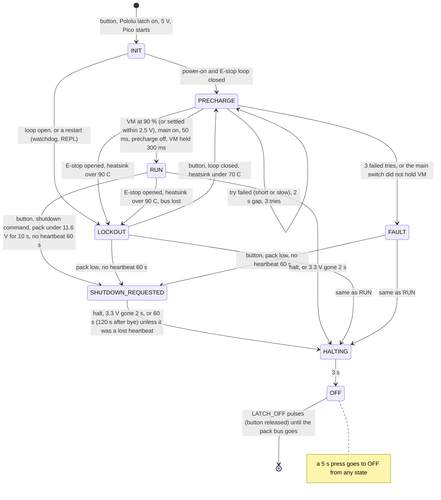

# ATLAS-PWR-1 supervisor (Raspberry Pi Pico, MicroPython)

The supervisor is a Raspberry Pi Pico plugged into two sockets on the rev B power board. It does
the jobs the STM32 on rev A's drive board did besides running the motor:

- precharges the motor bus and closes the main switch;
- latches the E-stop (the hardware cuts the motor bus; the Pico keeps it off until a person
  presses the button);
- presses the Jetson's power key, waits for the Jetson to halt, then switches the car off;
- reads the JBD BMS and reports to the Jetson once a second over USB;
- switches the lidar, runs the fan, watches the main-switch heatsink and the pack voltage.

It is plain MicroPython, so students can read and change it in Thonny with no compiler. The same
code runs on a PC against a simulated power board, which is how all of it has been tested so
far. **None of it has run on a Pico or on the real board yet** (see "What is unverified").

| File | What it is | On the Pico? |
| --- | --- | --- |
| `pins.py` | The GPIO map (from `boards/power/PINMAP.md` and the Pico nets in `boards/power/design.py`) and the analog scaling | yes |
| `hal.py` | The only file that touches `machine`: pins, ADC, UART, USB port, watchdog | yes |
| `jbd.py` | The JBD BMS protocol on UART0 at 9600 baud | yes |
| `link.py` | The JSON line protocol to the Jetson on USB | yes |
| `sequencer.py` | The state machine, and every timing and threshold in `Settings` | yes |
| `main.py` | Wiring, watchdog, LEDs; MicroPython runs it at power-up | yes |
| `sim.py` | A simulated power board for running everything on a PC | no |
| `tests/` | pytest: `python3 -m pytest firmware/supervisor/tests` | no |

## Putting it on a Pico

1. **MicroPython.** Hold the Pico's BOOTSEL button while you plug it into a computer. It shows up
   as a USB drive called RPI-RP2. Download the MicroPython UF2 for the board from
   https://micropython.org/download/RPI_PICO/ (a Pico 2 needs the RPI_PICO2 build) and drag it
   onto that drive. The Pico restarts as a USB serial port.
2. **The files.** Copy the six files marked "yes" above to the Pico's own file system. Do not copy
   `sim.py` or `tests/`.
   - Thonny: Tools > Options > Interpreter > "MicroPython (Raspberry Pi Pico)". Open each file
     and use File > Save as... > Raspberry Pi Pico, keeping the same name.
   - mpremote (`pip install mpremote`), from this folder:
     ```
     mpremote connect /dev/ttyACM0 cp pins.py hal.py jbd.py link.py sequencer.py main.py :
     mpremote connect /dev/ttyACM0 reset
     ```
3. **First start.** After `reset`, `main.py` runs. A `machine.reset()` counts as a restart, not a
   power-on, so the supervisor waits in LOCKOUT for a button press before it precharges (see
   below). That is on purpose.

On the car the Pico's micro-USB goes to a USB-A port of the Jetson dev kit, and the Jetson's
`atlas-battery.service` owns the port. To work on the Pico from the Jetson:

```
atlas supervisor repl --yes      # motor bus off, firmware stops, the service lets go of the port
mpremote connect /dev/atlas_supervisor cp sequencer.py :     # or Thonny, or screen
#   ... then Ctrl-D in a terminal (or `mpremote reset`) restarts the firmware
atlas supervisor resume          # the service takes the port back
```

The other way in is to move the Pico's cable to the power board's debug USB hub (its spare port)
and use a laptop. That is also the way to reach the supervisor when the Jetson is hung. On a
running car, moving the cable stops the Jetson's heartbeats, and 60 s later the supervisor asks
the Jetson to shut down (power key): send `hb_timeout 0` from the laptop within that minute (or
from the Jetson, `atlas supervisor hb-timeout 0`, before you move it).

### Getting back to the REPL

While `main.py` runs, the USB port carries the JSON protocol and a stray Ctrl-C does not stop it
(`micropython.kbd_intr(-1)`). There are three ways back to the `>>>` prompt:

- **Hold the power button at start-up** until both LEDs light (about 3 s after the Pico starts).
  The supervisor never starts; the outputs stay in their safe state.
- Send **`repl`** on the port (or `atlas supervisor repl --yes` from the Jetson).
- Press **Ctrl-C** in a terminal. Thonny and mpremote do this when they connect, so connecting
  them stops the supervisor. The bytes after the Ctrl-C are left for the REPL, so their
  handshake still works.

Leaving for the REPL always turns the motor bus off, kills the VESC, stops the watchdog and
leaves a `lockout.flag` file, so the next start waits for a button press. The Jetson, the lidar
and the latch stay as they were. While you are in the REPL nothing watches for the Jetson's halt,
so the car stays on until you restart the firmware (Ctrl-D) or switch it off with a 5 s press
(which only works while the firmware runs; otherwise unplug the pack).

Note on `os.dupterm`: on the RP2040 port it adds a second terminal; it cannot take the REPL off
the built-in USB port (`ports/rp2/mphalport.c` writes stdout to USB CDC and to every dupterm
stream). Taking the REPL off USB for real needs `machine.USBDevice` with the built-in driver
turned off and a CDC class from micropython-lib, which changes the USB descriptors and makes a
broken build harder to recover. Owning the port from `main.py` gives the same result for this job.

## Talking to it

```
screen /dev/atlas_supervisor 115200          # on the Jetson; quit with Ctrl-A then k
```

Type a command and press Enter. The Pico does not echo what you type (`picocom --echo` does it
locally). It prints a status line every second. If `atlas-battery.service` is running, stop it
first or use `atlas supervisor ...` instead, because two programs reading one port steal each
other's lines. Stopping the service sends "bye": 120 s later, unless the service comes back or you
send `hb_timeout 0`, the supervisor presses the Jetson's power key and the car shuts down.

### The protocol

One message per line, both ways, ending in LF (CR also ends a line, for terminals). Messages are
JSON objects. The Jetson sends `{"cmd": ...}`; the Pico sends `{"t": "status" | "ack" | "err" |
"evt", ...}`. An `"id"` in a command comes back in its reply. JSON objects without `"cmd"` are
ignored (so an echoing terminal cannot start a reply storm), and so are blank lines.

| Command | Arguments | What it does | Reply |
| --- | --- | --- | --- |
| `hb` | `boot` (first 8 hex digits of the Jetson's boot id), `up` (s) | Heartbeat, 1 Hz from atlas-battery.service. The first one arms the 60 s timeout (after it: power key while the Jetson is up, halt if it is not); a new `boot` value ends a reboot grace | none |
| `status` | | | a status frame |
| `lidar` | `on`: true/false | Lidar power. LIDAR_REQ edges do the same | `ack` with `on` |
| `shutdown` | | Same as a short button press: press the Jetson's power key, wait for its halt, switch off | `ack` with `started`, `state` |
| `reboot` | `hard`: true/false | The Jetson is rebooting: keep the power on and ignore its 3.3 V and heartbeat for up to 240 s. `hard` also pulses SYS_RESET* for 100 ms (for a hung Jetson, from a laptop on the hub) | `ack` with `grace_s` |
| `halt` | `verb`: poweroff, halt, reboot, kexec | Sent by the Jetson's systemd-shutdown hook at the very end. poweroff/halt: HALTING, then off 3 s later. reboot/kexec: as `reboot` (unless a shutdown was requested, then off) | `ack` with `verb`, `state` |
| `bye` | | atlas-battery.service is stopping. The heartbeat timeout becomes 120 s, and no more power-key presses for a shutdown already under way | `ack` |
| `bms_fets` | `charge`, `discharge`: true/false; `force`: true | JBD register E1. Turning discharge off cuts the whole car, the Pico included, so it needs `force` | `ack` with `queued`, or `err` |
| `fan` | `duty`: 0-100, or `auto`: true | Fan speed; auto follows the heatsink NTC | `ack` with `duty`, `auto` |
| `hb_timeout` | `s`: seconds, 0 = never | For bench work; back to 60 s at the next start | `ack` |
| `jetson_power_cycle` | `off_s`: 1-120 (default 10) | Switch the dev kit's DC feed off (DEVKIT_PWR, GP22) and on again, for a hung Jetson. A hard power cut: no shutdown. The reboot grace then covers its boot | `ack` |
| `log` | | The last 20 events | `ack` with `events` |
| `version`, `help` | | | `ack` |
| `repl` | | Make the motor bus safe, stop the watchdog, leave for the REPL (Ctrl-C does the same) | `ack` |

Plain words work too: `status`, `lidar on`, `lidar off`, `shutdown`, `reboot`, `reboot hard`,
`halt poweroff`, `fan 40`, `fan auto`, `bms_fets on`, `bms_fets charge_off`,
`bms_fets discharge_off force`, `bms_fets off force`, `hb_timeout 0`, `jetson_power_cycle 10`,
`log`, `help`, `repl`.

**Status frame** (once a second, and in reply to `status`):

| Field | Meaning |
| --- | --- |
| `state`, `why` | State (below) and the reason for it, for example `LOCKOUT` / `estop` |
| `phase`, `attempt`, `last_fail` | Precharge progress and the last failure (`short`, `slow`, `bat_sense`, `main_switch`) |
| `bat`, `vm` | Pack bus and motor bus from the Pico's dividers, V (pack averaged over about 2 s) |
| `fet_c` | Main-switch heatsink NTC, C (null if no NTC is fitted) |
| `estop`, `estops` | Loop closed now; number of openings since start |
| `main`, `kill` | MAIN_EN is high; VESC_KILL is low (motor stopped) |
| `chg`, `lidar`, `fan`, `fan_auto` | Charger present; lidar power; fan duty and mode |
| `low` | Pack under 12.0 V for 30 s |
| `pre_ms` | How long the last good precharge took to finish (use it to set `VM_CAP_UF`) |
| `jet` | `v33` (J12 3.3 V present), `up` (JETSON_UP), `hb` (s since the last heartbeat), `bye`, `grace` (s of reboot grace left), `boot`, `boots`, `presses`, `hb_timeout`, `power` (dev kit fed) |
| `bms` | `ok`, `age` (s), `v`, `i` (A, positive = discharging, as rev A's INA228), `soc` (%), `rem_ah`, `full_ah`, `cycles`, `prot` and `prot_names`, `fet_chg`, `fet_dsg`, `balance`, `temps` (C), `cells` (V), `timeouts`, `errors`, `fet_write` |

**Events** (`{"t": "evt", "evt": ..., "ms": ...}`): `boot`, `state` (`was`, `to`, `why`),
`estop` (`open`), `button` (`press`: short or long), `rearm_refused`, `precharge`,
`precharge_failed`, `power_key`, `hb_lost`, `jetson_up`, `jetson_booted`, `reboot`, `reboot_done`,
`reboot_grace_over`, `jetson_power` (`on`), `low_battery` (`level`: warn or shutdown), `bms` (`online`, `prot`),
`bms_fets`, `lidar` (`on`, `source`), `hb_timeout`, `latch_off`, `latch_stuck`, `power_returned`,
`crash`. atlas-battery.service writes them to
the journal: `journalctl -u atlas-battery`.

## The state machine



- **INIT** (100 ms): every output in its safe state, inputs settle.
- **PRECHARGE**: the precharge FET charges the ESC's capacitors through 10 ohm. Under 4 V at 10 ms
  (or under half of what R x C predicts, if that is lower) means a short. The bus counts as
  charged at 90 % of the pack, or when it is within 2.5 V of the pack and has stopped rising
  (under 0.1 V per 10 ms): the booting FSESC and the Castle BEC with the servo draw 150-200 mA
  through the resistor, so a healthy bus can settle short of 90 % (review M3). Not charged within
  5 time constants (100 ms for the assumed 2 mF) means a partial short or a bigger ESC
  capacitance. Then the main switch closes, 50 ms later the precharge FET opens, and VM must stay
  above 90 % for 300 ms. Three tries, 2 s apart.
- **RUN**: main switch on, VESC_KILL high (run). Watches for the bus dropping and a hot heatsink.
- **LOCKOUT**: main switch off, VESC killed. Reasons: `estop`, `fet_hot`, `bus_lost`,
  `restart`. A short press re-arms (precharges again) if the loop is closed, the heatsink is under
  70 C and the pack reads sane; otherwise it is refused (`rearm_refused` event) and nothing else
  happens (review m16). To switch off from LOCKOUT, shut the Jetson down (`sudo poweroff`,
  `atlas supervisor shutdown`) or hold the button for 5 s.
- **FAULT**: the precharge gave up or the main switch is broken. The red LED blinks the reason.
  A short press shuts the car down; fix the fault, then power-cycle.
- **SHUTDOWN_REQUESTED**: VESC killed and main switch off at once. The power key gets a 180 ms
  press, and another every 10 s for up to 60 s while the Jetson is clearly still running and has
  not said `bye` (review F6: a press on a Jetson that is already halting can start it again).
  After a button press, a `shutdown` command or a low pack, the supervisor stops waiting after
  60 s (120 s if the Jetson said `bye`) and switches off.
  After a **lost heartbeat** with the Jetson still powered (J12 3.3 V or JETSON_UP high: a crashed
  daemon or a loose Pico cable), it never cuts the Jetson: it presses the key every 10 s for 60 s
  and then waits for HALT or for the 3.3 V to go (review M4). A Jetson that is hung for good then
  needs a 5 s press, or `jetson_power_cycle` from a laptop. If the Jetson is evidently off (no
  3.3 V sense and JETSON_UP low), a lost heartbeat goes straight to HALTING.
- **HALTING**: main switch and lidar off; 3 s later, OFF.
- **OFF**: main switch, lidar and the dev kit's feed (DEVKIT_PWR) off. LATCH_OFF gets a 100 ms
  pulse every 500 ms, but only while the button is released, because the button also drives the
  Pololu's ON input (review M5), and only until the pack bus (VSYS_SW, read on BAT_SENSE) goes,
  or 20 pulses. Then the Pico normally loses power. If it keeps running on USB power from a
  laptop, it waits; when the pack bus comes back (someone switched the car on) it restarts as
  after a power-on (review m8). If the latch did not drop after 20 pulses, the red LED blinks
  fast and a short press tries again.

The E-stop never waits for the state machine: the 74HC08 cuts the main switch in hardware, and
an interrupt on the falling edge of ESTOP_OK drops MAIN_EN, PRECHARGE_EN and VESC_KILL within
microseconds, so closing the loop again cannot re-close the switch onto a drained bus.

**The button.** The press that switched the car on is ignored. A short press (30 ms to 5 s) acts
when it is released: shut down in PRECHARGE, RUN and FAULT, re-arm (or nothing) in LOCKOUT
(above). A press held for 5 s is a forced off: at 5 s the motor bus, the precharge, the lidar and
the dev kit's feed go off and both LEDs light; LATCH_OFF follows when you let go.

**LEDs** (the Pico's own LED copies the green one):

| State | Green (LED_STATUS) | Red (LED_FAULT) |
| --- | --- | --- |
| INIT, PRECHARGE | fast blink, 5 Hz | off |
| RUN | on; a short dark blink every 2 s while the Jetson's heartbeat arrives | off |
| LOCKOUT | on when the loop is closed (press to re-arm) | blink, 1 Hz |
| FAULT | off | 2, 3, 4 or 5 flashes then a pause: short, slow precharge, pack sense, main switch |
| SHUTDOWN_REQUESTED, HALTING | blink, 2 Hz | off |
| OFF | off; on while the button is still held (let go to switch off) | off; on while the button is held; fast blink if the latch did not drop |
| low pack (RUN, LOCKOUT) | | double flash every 3 s |
| REPL (button held at start, or after `repl`) | on | on |

**Watchdog.** 3 s. If the main loop stops, the Pico resets; during the reset its pins float and
the board's pull-downs turn the main switch, the precharge FET, the lidar and VESC_KILL off, while
the Jetson stays powered. After the reset the supervisor waits in LOCKOUT (`restart`). An
unexpected exception does the same on purpose, after writing `crash.txt` on the Pico.

### Timings

All of them are in `sequencer.Settings`, each with rev A's value (from
`firmware/vesc/hw_atlas_drv1.c`) and the reason for the new one. The main ones:

| Setting | Value | Rev A | Why |
| --- | --- | --- | --- |
| `PRECHARGE_TAUS` x `PRECHARGE_R_OHM` x `VM_CAP_UF` | 5 x 10 ohm x 2 mF = 100 ms | 400 ms (460 in practice) | rev B spec: 90 % within 5 tau; the FSESC's capacitance is assumed |
| `PRECHARGE_SETTLED_MARGIN_V`, `PRECHARGE_SETTLED_DV` | 2.5 V, 0.1 V per 10 ms | "settled above 9 V" | review M3: a loaded bus settles short of 90 % |
| `PRECHARGE_SHORT_CHECK_MS`, `PRECHARGE_SHORT_V` | 10 ms, 4 V | same | plus the R x C scaling so a healthy bus on a low pack passes |
| `PRECHARGE_RETRY_GAP_MS` | 2 s | 15 s | rev A's gap protected 2512 chip resistors; rev B has a 5 W wirewound |
| `PWR_KEY_PULSE_MS` | 180 ms | 1000 ms | 150-200 ms; long presses can force a hard power-off |
| `REPRESS_MS`, `SHUTDOWN_WAIT_MS` | 10 s, 60 s | same | |
| `HB_TIMEOUT_MS`, `BYE_GRACE_MS`, `REBOOT_GRACE_MS` | 60 s, 120 s, 240 s | none | rev B spec; then the power key, not a cut, while the Jetson is up (review M4) |
| `V33_LOST_MS` | 2 s | 3 s (OS_HALTED) | the dev kit has no OS_HALTED pin |
| `HALT_TO_OFF_MS` | 3 s | 0.1 s | rev B spec |
| `DEBOUNCE_MS`, `LONG_PRESS_MS` | 30 ms, 5 s | 30 ms, none | rev B spec |
| `FET_HOT_C`, `FET_REARM_C` | 90 C, 70 C | none | rev B spec; hysteresis is a judgment call |
| `BAT_LOW_V` / `BAT_CUT_V` | 12.0 V for 30 s / 11.6 V for 10 s | none | rev B spec; the 10 s is a judgment call. With a charger in, paused only while the pack rises over 0.05 V per 10 s (review m7) |
| `OFF_RETRY_MS`, `OFF_MAX_PULSES`, `BAT_GONE_V`, `BAT_BACK_V` | 0.5 s, 20, 4 V, 9 V | KILL held | review M5 and m8 |

## Trying it on a PC

```
python3 -m pytest firmware/supervisor/tests          # 119 tests, about 4 s
cd firmware/supervisor && python3 -c "
from sim import Rig
r = Rig(); r.run(1000); print(r.state(), r.seq.status()['pre_ms'], 'ms')
r.hw.set_input('ESTOP_OK', 0); r.run(100); print(r.state(), r.seq.why)"
```

`sim.Rig` runs the real `main.App` on simulated hardware: the precharge RC (exact), the hardware
AND gate, the NTC, the Jetson's lines, and a JBD BMS answering real frames. `Rig(vm_load_a=0.2)`
loads the motor bus as the booting FSESC and the Castle BEC do (200 mA at the pack voltage). The Jetson side's
tests (`software/jetson/tests/test_integration_firmware.py`) run this same firmware against the
Jetson tools over a pseudo-terminal.

## What is unverified

- **Nothing has run on MicroPython.** The tests run under CPython; `tests/test_micropython_compat.py`
  only checks that the six Pico files avoid modules and syntax MicroPython lacks.
- **The JBD frame format** comes from JBD's "General Protocol V4" document and esphome-jbd-bms;
  no frame from the team's BMS has been seen. The 100 mA unit flag (bit 7 of the FET byte) is from
  esphome-jbd-bms only. The V4 document has an arithmetic slip in one example (it says 24.7 C for
  0x0B98; it is 23.7 C).
- **The pin map** follows `boards/power/PINMAP.md` (GP15 CHG_PRESENT_N, active low; GP22
  DEVKIT_PWR, an output, 10 k pull-up); `tests/test_pins.py` checks pins.py against PINMAP.md and
  against the Pico nets in `boards/power/design.py`, and both pass.
- **Polarities and values** from the board design: both BMS optocouplers non-inverting, the fan
  PWM inverted by the 2N7000, 100 k / 18 k bus dividers, a Vishay NTCLE100E3103JB0 NTC (B 3977 K)
  with a 10 k pull-up.
- **The FSESC's input capacitance** (`VM_CAP_UF`) and the real load on VM: read `pre_ms` from the
  status after the first power-up and adjust. On the simulator a bus loaded with 150-200 mA
  finishes in 80-90 ms against the 100 ms timeout, so there is little margin if the FSESC has more
  than 2 mF; bench-test it on 10 ohm (review M3).
- **The Pololu #2813 OFF input** is pulsed only with the button released, as its product page
  describes ON and OFF as separate pulses. Bench-check that a release then a pulse turns it off.
- **Stopping the watchdog** for the REPL writes the WATCHDOG CTRL register directly
  (`hal.stop_watchdog`, addresses from the Pico SDK's register headers); not yet tried on a Pico.
- **USB IDs**: MicroPython's rp2 port uses 2e8a:0005 (`ports/rp2/mpconfigport.h`); a custom build
  or CircuitPython would differ.
