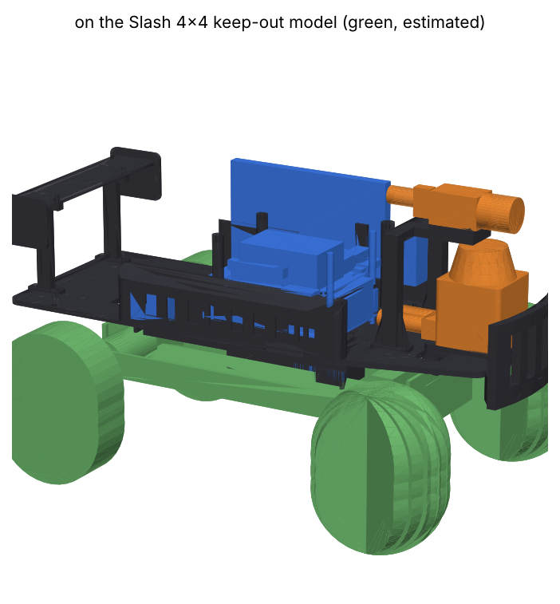
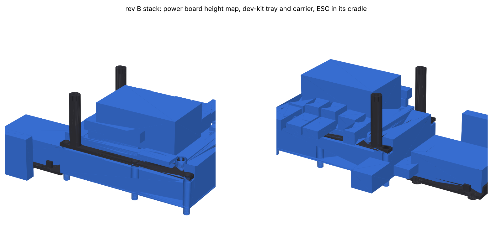

# Printed kit

The kit is one CadQuery script, `kit.py`. It builds every part and places it on a keep-out model of the
Slash 4x4. Then it checks every pair of solids for overlap, slices the lidar scan plane, exports STEP and STL,
and renders PNGs.

`extras.py` builds on it and adds the parts that finish the car: the canopy over the dev kit with the Wi-Fi
antennas, the wheels-off bench stand, the mating plugs, and every cable as a path through the model. It checks all
of them against the kit and writes `out/extras_report.json`. The cable lengths from that report are in
`../docs/WIRING.md`, and `../docs/COMPLETE_CAR.md` explains each rev A addition.

    pip install cadquery ezdxf shapely matplotlib
    python3 kit.py                 # about 1 minute; writes out/ and out/kit_report.json
    UNDER_CLEARANCE=42 python3 kit.py    # any number in P can be overridden the same way
    POWER_L=150 python3 kit.py     # e.g. another power board length (the layout's is 130, the default)
    SHEET_PARTS=all python3 kit.py # check the laser-cut versions in place of the printed ones (also tray,bms,canopy,splices)
    python3 extras.py              # about 2 minutes; canopy, bench stand, plugs and cables, out/extras_report.json
    python3 ../boards/board_outlines.py   # the power board outline, holes, keep-outs and height map

Both scripts also write the laser-cut parts as DXF and SVG profiles to `out/laser/` (see Laser-cut parts below).

## Rev B (24 October)

Rev B replaces the two rev A boards with the through-hole ATLAS-PWR-1 power board and the NVIDIA dev-kit carrier
the team owns, uses the owned Flipsky FSESC, and moves the BMS to the pack. `NOTES_REVB.md` has the judgment
calls, the parameters still to measure and the print list. In the model:

- The **power board** (car x -32 to -32 + `POWER_L`, y -68 to 16) sits on six 7 mm deck standoffs. Its parts are
  modelled as the agreed height map: at most 23 mm under the dev kit (board-local X 20 to 120), at most 35 mm in
  the rear strip (X 0 to 20) and the front strip (X over 120), and at most 23 mm in the 9 mm bands along both long
  edges where the tray's arms run.
- A printed **dev-kit tray** stands on the same six holes with M3 x 25 standoffs, so its underside is 25 mm above
  the board. It is a 3 mm frame. The carrier sits on four 7 mm bosses at its own holes (`DEVKIT_HOLES`, not yet
  measured), with its I/O edge toward the pack. The canopy sits on two pillars printed on the tray's rear arms and
  two M3 standoff stacks over the board's front standoffs (on a board this short the front pillars would sit on the
  front standoffs' screw heads), plus a printed leg in zone B.
- A 3 mm **acrylic shield** hangs under the tray over the FET heatsink bar, which is live at pack voltage, because
  the CF-filled tray conducts.
- The **FSESC** sits in a printed cradle in the ESC bay beside the motor (x -113 to -35). The right pod's fan
  (x -94 to -54) blows across it, and the motor leads drop straight through a new deck opening at its motor end.
- The **JBD BMS** (160 x 105 x 10 mm) stands on its long edge in a printed holder on the pack lid's outboard edge.
  It is too big to lie on the 138 x 51 mm lid or to go inside the pack box.
- The aluminium heat spreader, its deck vents and DXF, the right pod's camera-plug slot and its tie slots are gone.
  The right pod gets windows for the charge USB-C, the debug USB-C and the power button.
- The default board length is the layout's 130 mm (`boards/power/layout.py`). At 150 mm the board's front-left
  corner sits inside the lidar's M12 plugs.

## Last run (24 October, rev B)

- **At the default `POWER_L` of 130 mm**, both scripts report zero interference: printed parts, bought parts, the
  height-map blocks, the acrylic shield, the chassis keep-outs, the plugs and all 31 cable runs. No cable crosses
  another. The lidar plugs end 16.6 mm ahead of the board.
- **With `SHEET_PARTS=all`** (laser-cut tray, BMS holder, canopy box and splice plates in place of the printed ones),
  the result is the same: zero everywhere.
- **At `POWER_L=150`**, `kit.py` finds four overlaps, all between the lidar's M12 plug envelope and the front of the
  board (the plugs end at x 114.6, an estimate, MEASURE_FIRST item 12; a 150 mm board reaches x 118), and the lidar
  Ethernet cable runs through the board's front.
- Everything that crosses the lidar's scan plane (the camera arch legs, the wing, the tray's pillars, the BMS and its
  holder, the canopy leg, the dongle, a few cables) sits inside its rear blind sector.
- Stack heights: power board top z 8.6, tray 33.6 to 36.6, carrier 43.6 to 45.2, fan top 77.2 (32 mm heatsink,
  unmeasured), canopy posts 48 mm above the tray (top z 84.6), canopy underside 85.6 (8.4 mm over the fan), canopy
  top 88.0. The carrier's underside parts clear the tray by 1 mm, the tray clears the board's 23 mm parts by 2 mm,
  and the shield (z 30.6 to 33.6) is 2 mm over the bar's live metal (20 mm high, an estimate, MEASURE_FIRST 28).
- The pack box is unchanged: inside the battery bay with 2.8 mm under it.
- Two fixes from this run: the printed canopy's corner radius went from 12 to 6 mm (its inner corner fillet reached
  the right-hand posts, a 6.5 mm3 overlap that an over-broad "touching by design" list had hidden), and the canopy leg
  moved to y 44.

## Parts

**Before printing, read [PRINTING.md](PRINTING.md):** several STLs in `out/stl` are not in a printable orientation (the bumper failed on Sept 30). It lists which parts to flip and which need supports, and has the rev B parts.

Sizes are as they sit on the bed (mm). Mass is for solid PETG-CF; with 4 walls and 35 %
gyroid expect about 65 % of it. Everything fits a 250 x 250 bed (Bambu P1S: 256).

| part | print | bed size | solid mass | orientation, notes |
| --- | --- | --- | --- | --- |
| `fit_coupon_front`, `fit_coupon_rear` | 1 each, FIRST | 56-58 x 132 x 25 | 55 / 57 g | top face down, like the deck. Strips of the deck across the towers and body posts: test the saddles and post slots on the real car. Both on one plate: 2 h 30 min, 67 g (P1S, 35 % gyroid) |
| `deck_rear`, `deck_mid`, `deck_front` | 1 each (rev B holes) | 146-162 x 178 x 15-25 | 180 / 167 / 171 g | top face down; saddles and ribs point up, no supports. The three pieces butt together and bolt to splice plates underneath. A printed rev A `deck_rear` and `deck_front` can be converted by hand (PRINTING.md); `deck_mid` cannot |
| `splice_rear_left`, `_right`, `splice_front_left`, `_right` | 1 each | 30 x 72 x 3 | 8 g | flat; 6 x M3 bolts + nylocs each, across the joint |
| `lidar_plinth` | 1 | 70 x 64 x 6 | 24 g | pocket face down; 2 x M3 x 6 into the TiM561's bottom threads (2.0 mm engagement, SICK allows 2.8) |
| `bumper` | 1 | 62 x 124 x 74 | 113 g | flange down; bolts up through the deck into the plinth (4 x M3 x 16) |
| `camera_arch` | 1 | 80 x 102 x 104 | 83 g | feet down; the tongue is a 34 mm bridge |
| `camera_cradle` (0 deg), `_down5`, `_down10` | pick one | 43 x 34 x 4-8 | 7 g | flat; slotted +-1.5 mm for the camera's M3 holes |
| `side_pod_left`, `side_pod_right` | 1 each (right pod is rev B) | 225 x 25 x 50 | 80 / 68 g | outer face down, vents vertical; the right pod holds the 40 mm fan over the ESC and has three windows through both walls for the charge USB-C, the debug USB-C and the button |
| `wing_blade` | 1 | 55 x 190 x 46 | 72 g | endplates up |
| `wing_strut_left`, `_right` | 1 each | 35 x 88 x 14 | 16 g | on their side |
| `pack_box` | 1 | 138 x 51 x 72 | 67 g | open end up |
| `pack_lid` | 1 | 138 x 51 x 4 | 27 g | ribs up |
| `cell_holder_bottom`, `_top` | 1 each | 120 x 40 x 5 | 12 g | pockets up |
| `post_washer` | 4 | 30 x 30 x 3 | 3 g | body clips sit on these above the deck |
| `devkit_tray` (rev B) | 1 | 130 x 84 x 51 | 29 g | frame down, bosses and canopy pillars up, no supports. Carries the dev-kit carrier over the power board; or cut it (`laser_devkit_tray`) |
| `esc_cradle` (rev B) | 1 | 75 x 61 x 9 | 10 g | base down. Placeholder size until the cased FSESC is measured |
| `bms_fence` (rev B) | 1 | 164 x 17 x 63 | 29 g | base down. Holds the JBD BMS on edge on the pack lid |
| `canopy_leg` (rev B) | 1 | 14 x 29 x 85 | 13 g | foot down; the canopy's front-left post, on the front joint's two left bolts |
| `stack_canopy` (extras.py, rev B outline) | 1 | 128 x 129 x 6.4 | 54 g | top face down, no supports; cover over the dev kit and its plugs with the antenna jacks and the fan grille; or cut it as a box (`laser_canopy_*`) |
| `bench_stand` (extras.py) | 1, PLA | 173 x 123 x 128 | 267 g solid (PETG-CF density) | pad face down; a workshop tool, not on the car |

Total about 1.3 kg solid for the parts on the car, about 0.85 kg of filament as printed. The rev B prints alone
are about 0.37 kg solid (0.24 kg printed) if a printed rev A `deck_rear` and `deck_front` are converted by hand, and
0.72 kg solid (0.47 kg printed) if all three deck pieces are reprinted (`NOTES_REVB.md`).

## Material and settings

CF-filled filament is abrasive: use a hardened-steel nozzle (0.4 or 0.6 mm), and dry the
spool first.

| part | material | settings |
| --- | --- | --- |
| deck halves, plinth, arch, wing struts | PETG-CF (or PA-CF if the printer has an enclosure and a dry box) | 0.2 mm layers, 4 walls, 35 % gyroid, 5 top/bottom |
| bumper | PETG-CF; PA-CF is tougher in a crash | 5 walls, 40 % gyroid |
| side pods, wing blade, pack lid | PETG-CF | 3 walls, 20 % gyroid |
| pack box, cell holders | PETG-CF or plain PETG | 3 walls, 30 %; holders at 100 % so the pockets stay round |
| dev-kit tray, ESC cradle, BMS holder, canopy leg | PETG-CF | 4 walls, 35-40 % gyroid (the tray at 40 %) |

Do not rely on CF-filled plastic as electrical insulation: carbon fibre conducts. The pack
has fish paper and Kapton for that. The BMS holder is CF-filled too: keep the BMS's own insulation (heat-shrink or
its case) on, and no bare copper against the holder.

## Hardware

- M3 brass heat-set inserts (4.0 mm hole, 5 mm deep), about 34: in the deck for the power board 6, the ESC cradle
  2, the pack box 6, the camera arch 4, the side pods 5 and the wing 4; in the plinth 4; at the tops of the tray's
  two rear pillars and the canopy leg 3. Buy 50.
- Deck joints: 24 x M3 socket screws and nylocs through the deck and the four splice plates: 20 x M3 x 12, and
  4 x M3 x 16 where a part shares a joint bolt (the ESC cradle's two outboard tabs at (-90, -60) and (-70, -60),
  the canopy leg's foot at (92, 40) and (92, 60)).
- Stack: 6 x M3 x 7 mm male-female standoffs from the deck inserts to the power board, and 6 x M3 x 25 mm
  male-female standoffs whose male ends screw through the power board into the 7 mm ones. M3 x 8 countersunk screws
  (ISO 10642) through the tray into the 25 mm standoffs, heads flush under the carrier: four at a 130 mm board,
  where the front two standoffs take the canopy's front post stacks instead (six at a 150 mm board).
  4 x M2.5 x 10 thread-forming screws for plastic through the carrier into the tray's bosses (if the carrier's holes
  turn out to be M3, use M3 x 10 and set `DEVKIT_PILOT_D=2.6`).
- ESC cradle: 2 x M3 x 8 into the new inserts, the 2 shared joint bolts above, 2 zip ties (3.6 mm, 200 mm) over
  the case.
- BMS: 2 x M3 x 10 countersunk through the holder's base and the pack lid into the lid's two outboard inserts (they
  replace the lid's own screws there), 4 zip ties round the BMS and the uprights. The MIDI fuse holder goes on the
  lid with VHB tape or two zip ties.
- Canopy: 5 x M3 x 8 button heads into the two rear tray pillars, the leg and the two front posts. The front posts
  are M3 hex standoffs, 40 mm male-female plus 8 mm male-female: the 40 mm one's male end goes through the tray into
  the front 25 mm standoff in place of the countersunk screw there.
- FET shield: 3 mm acrylic (`out/laser/laser_fet_shield.dxf`), 2 x M3 x 10 nylon countersunk screws down through the
  tray, nylon nuts under the shield.
- Lidar USB-Ethernet dongle: 2 zip ties round it and the camera arch's left leg.
- M3 socket screws 6-16 mm for the rest, and the chassis's own body clips over the post washers.
- Two RP-SMA antennas and two pigtails from the Wi-Fi card to the canopy (20 cm: the routed runs are 104 and 161
  mm), and zip ties (`../docs/WIRING.md`).

## Assembly order

1. Heat-set all inserts. Bolt the three deck pieces to the splice plates; leave out the four joint bolts that the
   ESC cradle and the canopy leg share.
2. Pack: build it (`docs/PACK_BUILD.md`), drop the box into the bay through the deck window, lid on with its four
   inboard screws.
3. BMS holder on the lid's outboard edge (2 countersunk M3 x 10), the BMS into its channel, zip ties. MIDI fuse
   holder on the lid. Wire the battery assembly: pack - to the BMS B-, the sense lead through its adapter to the
   BMS, pack + to the fuse, the fuse and the BMS P- to the XT90-S, the BMS UART lead. Leave the XT90-S unplugged.
4. Deck onto the towers, posts through the slots, washers and body clips on.
5. Lidar screwed to the plinth on the bench; plinth, deck and bumper bolted together from below.
6. Camera arch, cradle, camera. Zip-tie the USB-Ethernet dongle upright against the rear face of the arch's left
   leg, jack down, and plug the lidar's Ethernet lead into it.
7. ESC cradle (2 M3 x 8, and M3 x 16 through the two outboard rear-joint holes), the FSESC zip-tied in it. Phase and
   hall leads straight down through the opening at the FSESC's motor end to the motor.
8. 7 mm standoffs, the power board, then the 25 mm standoffs through it. Plug everything on the board's rear and
   front edges and on its right edge now (ESC XT60 and COMM, FSESC USB, servo, lidar power, camera power, fan,
   E-stop): the tray's arms run over those edges. The ribbon and the J14 harness go onto the board's box header and
   1 x 12 header now as well.
9. The acrylic shield under the tray (2 nylon screws, nuts underneath), then the tray (countersunk M3 x 8 at the
   rear and middle standoffs, the two 40 mm front post standoffs at the front). Clip the two Wi-Fi pigtails onto the M.2 card and lead them out under the
   carrier's I/O edge, then put the carrier on the bosses (4 M2.5 x 10). Ribbon onto J12, harness onto J14 (pin 1
   marked, printed key clip), DC lead, the two USB-A leads (Pico, dongle), the USB-C lead to the hub, the camera's
   RJ45.
10. Side pods (fan in the right one), wing. The runs are in `docs/WIRING.md`.
11. Canopy leg (M3 x 16 through the front joint's two left holes), then the canopy (5 x M3 x 8), with the pigtails'
    RP-SMA jacks nutted into its two holes. Screw the antennas on last.

## Laser-cut parts

The school's CO2 laser can cut five rev B parts from 3 mm sheet instead of printing them. `kit.py` and `extras.py`
write each as a 2D profile to `out/laser/` (DXF with CUT and ENGRAVE layers, and SVG), drawn kerf-neutral with M3
holes at 3.2 mm:

- `laser_fet_shield`: 3 mm cast acrylic, new, always fitted (the printed tray is CF-filled and conducts; the FET bar
  under it is at pack voltage);
- `laser_devkit_tray` (with printed `devkit_spacers` or stacked `laser_spacer_disc`), in place of `devkit_tray`;
- `laser_bms_base`, `laser_bms_wall_in`, `laser_bms_wall_out`, in place of `bms_fence`;
- `laser_canopy_top` and four `laser_canopy_skirt_*`, a slot-and-tab box in place of `stack_canopy`;
- `laser_splice` (4 off), in place of the four splice plates.

`SHEET_T` (the measured sheet thickness, default 3.0) sets every tab and slot; `SHEET_PARTS` swaps the printed parts
for the sheet ones in the checks. Material, which parts are better cut than printed, the tab and slot sizing rule and
the parts that stay printed are in [PRINTING.md](PRINTING.md), section "Laser-cut parts".

## What the model does not know

Every chassis dimension is an estimate carried over from car 1 until it is measured
(`docs/MEASURE_FIRST.md`). The camera's bottom hole spacing is an estimate. The TiM561's
swivel-unit and plug sizes are estimates (the SICK drawing does not give them). Rev B adds more (MEASURE_FIRST items
17 to 26): the dev-kit carrier's hole positions, the heights above and below it and the positions of its headers
and ports; the cased FSESC's size and where its leads leave; the BMS's terminals; the fuse holder and the dongle.
The power board's connector positions in `extras.POWER_CONN` are placeholders until the layout reports them.
